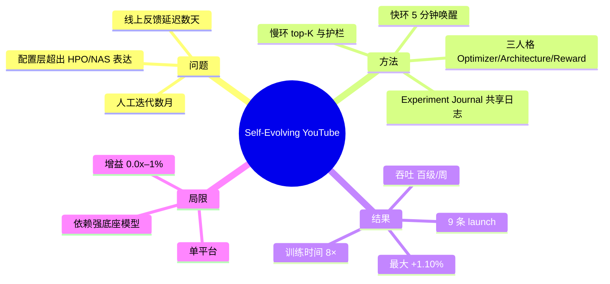
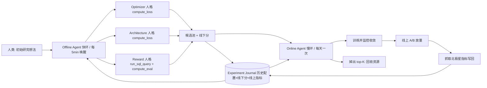

# 自进化推荐系统：用 LLM Agent 端到端自主优化工业级推荐模型（arXiv:2602.10226）

> **英文标题**：Self-Evolving Recommendation System: End-To-End Autonomous Model Optimization With LLM Agents  
> **作者 / 机构**：Haochen Wang\*、Yi Wu\*、Daryl Chang\*、Li Wei、Lukasz Heldt（\*同等贡献），Google Inc.  
> **发表**：RecSys '26（Minneapolis，2026-09-27 至 10-02）；arXiv:2602.10226v3 [cs.LG]，2026-08-02；9 页含参考文献，无附录  
> **代码**：未开源（原文未给出任何仓库或权重链接）  
> **一句话**：把「优化器 / 架构 / 奖励函数」这层配置 Φ 交给共享 Experiment Journal 的快慢双环 LLM Agent 去自动改代码、跑训练、下 A/B，在 YouTube 多个 surface 上拿到 0.05%–1.10% 的线上增益，并把实验吞吐从 Θ(1)–Θ(10)/周 推到 Θ(100)/周。

## 思维导图

## 0. 三十秒速览

| 项 | 内容 |
|---|---|
| 解决什么问题 | 工业推荐模型的「上层配置」优化（优化器规则、网络拓扑、奖励逻辑）超出 HPO/NAS 的搜索空间表达能力，历来只能靠人类 MLE 手工迭代数月 |
| 核心手段 | 双环 Agent：快环（Offline，5 min 唤醒、日任务）按三个人格生成 delta 改动并用线下代理打分；慢环（Online，日任务）按线上指标重排 top-K，接管训练/A-B/回收 |
| 关键结果（实验/离线） | 消融中完整版归一化 loss −0.84 [−1.70, −0.01]，换 Gemini 2.5 Flash 退化到 0.85 [0.66, 1.05]（Table 4）；训练时间累计 8×（先 4× 再 2×，§5.2.2） |
| 关键结果（线上/生产） | Table 1/Table 2 共 9 条 launch：最大 surface 级增益 +1.10% [+0.98, +1.22]（Wide & Deep，Table 2），奖励超参调优 +0.21% [+0.13, +0.29]（Table 1）；过去 6 个月本 surface 全部 launch 中，Agent 的改进优于 64%（YouTube 级）/ 73%（surface 级）的人工 launch（§5.1） |
| 是否开源 / 是否上生产 | 未开源；已上生产，多个 YouTube surface 实际放量 |
| 我最该记住的一点 | 「按反馈延迟切环」+「delta 而非全量配置」这两条工程决策，比 Agent 用什么 prompt 更能决定系统能不能跑起来——前者把贵流量留给 top-K，后者让 Θ(100) 条历史能塞进上下文 |

## 1. 摘要（忠实译述）

优化大规模机器学习系统（例如面向全球视频平台的推荐模型）需要在巨大的超参搜索空间中导航，更关键的是要设计精巧的优化器、架构与奖励函数，以刻画细微的用户行为。在这些方面取得实质性改进并非易事，传统上依赖大量人工迭代来检验新假设。作者提出一个自进化系统，利用大语言模型（具体为 Google Gemini 系列）在端到端自动化工作流中自主生成、训练并部署高性能的复杂模型改动。该系统由两部分组成：Offline Agent（快环）执行高吞吐的假设生成，以代理指标为优化目标；Online Agent（慢环）在真实生产环境中用延迟到达的北极星业务指标验证候选。两个 Agent 扮演专职机器学习工程师（MLE），展现出深度推理能力，发现了优化算法与模型架构上的新颖改进，并构造出针对长期用户参与度的创新奖励函数。该方法在 YouTube 的多次成功生产 launch 中体现了有效性，确认自主的、LLM 驱动的进化在开发速度与模型性能两方面都能超越传统工程流程。

## 2. 核心贡献

1. **面向工业级系统的自主 MLE 框架**：给出一个分层多 Agent 系统，让专职 LLM Agent 像专家 MLE 一样进化推荐模型，并把「假设生成 → 代码实现 → 训练 → A/B 测试 → 指标回流 → 资源回收」的完整生命周期纳入自动化闭环 —— 目标是吃掉「把 idea 变成可上线实验」这段最贵的机械劳动。
2. **语义级发现而非数值调参**：证明 Agent 能越过固定搜索菜单，写出新的架构组件（Gated Path/GLU 结构、GELU+LayerNorm 的激活细化）与多目标奖励函数，并在线上指标上站住 —— 这类改动此前只有人类专家能做，因为它要求读懂代码、理解业务口径，而非采样一个标量。
3. **实验速度的可量化提升**：用线下 + 线上 + 生产部署的完整证据链说明 Agent 系统能超过人工调优的基线，并把实验吞吐提高一个数量级（Table 5）—— 等价于同样时间预算下能探索配置空间的长尾。

## 3. 问题与动机

工业推荐系统正被表述为 RL 问题（§1），目标从 CTR 转向长期满意度。由此产生一个对齐缺口：模型训练用的是可微代理损失，真正要最大化的用户满意度却是不可微、延迟 Θ(days)–Θ(weeks)、稀疏且语义复杂的量（§2.3）。作者引用的两条前人路线都不够用：

- **HPO 系（Google Vizier、Auto-Sklearn、贝叶斯优化、高斯过程）**：只能在预定义参数区间内搜索连续超参，缺少「解释某配置为什么成功/失败」的语义深度（§2.1）。
- **NAS / 优化器搜索系（DARTS、演化搜索、Symbolic Discovery of Optimization Algorithms）**：能做结构改进，但受限于搜索空间本身，只能在预定义算子菜单里选或重组，无法发明新模块、无法重构代码修瓶颈（§2.1）。
- **「AI 科学家」系（Voyager、MetaGPT、AlphaEvolve、The AI Scientist、MLE-STAR）**：能直接改源码，但优化目标是静态数据集与学术基准（ImageNet、Kaggle 一类）；搬到生产后会遇到噪声反馈、安全护栏、复杂用户-系统交互与严格 A/B 协议（§2.2）。

作者的关键观察是：在成熟系统里，收益最高的改动恰恰落在「数值调参够不到」的语义与结构层面 —— 有 Θ(100) 量级的信号与组合（观看时长、问卷、留存等）可以用来逼近长期满意度，人类研究者常在这么大的空间里几个月都困在次优区域（§5.3.1）。另一条反直觉的工程观察在 §4.1.1：把整个代码库塞给单一巨型人格时，约 400k token 起就开始幻觉，所以必须按组件拆人格。

## 4. 方法

### 4.1 总体框架

系统把「找最优配置 Φ\*」拆成两个同步的推理环，二者共享一本 Experiment Journal（持久知识库，存全部历史配置、线下分与可得的线上指标）。形式化上这是双层优化：下层在固定 Φ 下训练排序模型，

$$\theta^{*}(\Phi)=\arg\min_{\theta}\; L_{\text{proxy}}(\mathcal{D};\theta,\Phi)$$

其中 $\mathcal{D}$ 是训练日志，$\Phi$ 是系统元配置（优化器、架构、奖励定义），$L_{\text{proxy}}$ 是可微代理损失；上层用昂贵的线上反馈选 Φ，

$$\Phi^{*}=\arg\max_{\Phi}\; M\big(\theta^{*}(\Phi)\big)\quad \text{s.t.}\quad G(\Phi)\le C$$

$M$ 是北极星指标，$G$ 是系统级约束（如训练成本），$C$ 是预算上限（§3.1、§3.2）。$\Phi$ 的三个具体成分是：优化器 $\eta\in\Phi$（学习率与更新规则，如 AdaGrad）、架构 $\phi\in\Phi$（排序网络结构，如 DCN）、奖励定义 $r\in\Phi$（决定训练标签的逻辑）。

图里最容易忽略的边是 `C --> J`：快环打分立刻写回日志，慢环读到的是「按线下分排序 + 逐步补线上分」的混合视图，两环无需直接通信。

### 4.2 Offline Agent（快环）：三个人格与三种打分口径

快环是高频候选提名器，每天跑一次任务、每 5 分钟唤醒一次，每次唤醒做三件事之一或全部：提名新候选、按最新一天用户数据调度训练与 SQL 分析、给候选打线下分（§4）。它按组件拆成三个专职人格，每个只改 Θ(10) 行代码、落在 Θ(1000) 行规模的模型定义里 —— 这正是人类工程师单次改动的典型体量（§4.1.1）。

- **Optimizer 人格（工具 compute_loss）**：搜优化算法与内部超参（momentum、batch size 等）。损失定义不变即尺子不变，验证 loss 可比，可直接排序 $\Phi_A\succ\Phi_B\iff L_{\text{proxy}}(\Phi_A)\lt L_{\text{proxy}}(\Phi_B)$（§4.1.1）。
- **Architecture 人格（工具 compute_loss）**：解析架构定义、提结构变异（把 embedding 换成 Gated Path、子塔加 layer norm）；同样用 loss 打分，越低说明拓扑越可学（§4.1.1）。
- **Reward 人格（工具 run_sql_query + compute_eval）**：多步推理 —— 先在海量用户日志上做开放式分析找假设（论文给的例子是「被分享的视频观看时长更高」，用分享 vs 未分享的平均观看时长对比支撑），再据此改训练标签逻辑。关键约束：改奖励会重塑优化地形，跨奖励定义比较 $L_{\text{proxy}}$ 本身是病态的（「只优化点击」的奖励天然比「点击+满意度」的 loss 低，因为后者更难学），所以该人格不能用 compute_loss，只能改用 compute_eval 算与理想用户行为高度相关的代理指标 —— 典型是 long-watch correlation，即模型预测与实际长观看发生的一致性，越高说明模型越会推用户真正愿意看完的内容（§4.1.1）。

三个人格共用一套 prompt 模板（人格 / 任务 / 上下文 / 输出格式 / guardrails 五段，Fig. 4），差异只在注入的 `{AGENT_TASK}`（Fig. 2、Fig. 3）。输出被硬约束成两个字段：`explanation` 与 `delta`（相对当前配置的增量）。guardrails 直接写进 prompt，例如「Keep Metric#3 ≤ +1%」（Fig. 2）。

### 4.3 Online Agent（慢环）：五阶段生命周期

慢环每天一次，读全池候选、给出 top-K 排序（日志虽按线下分排序，但它必须把线上指标也纳入才能产出精炼排序），然后按三类路径分派，接管五个阶段（§4.2）：

1. **Selection**：新进 top-K 的候选走 (2)(3) 开始训练与实验；已在实验中且仍在 top-K 的走 (4) 继续收指标；掉出 top-K 的走 (5) 回收资源。
2. **Model Training**：训练新配置并监控收敛，确保权重被正确版本化与导出。
3. **Live Experimentation**：给新训好的模型分配生产流量，开始线上实验。
4. **Metric Synthesis**：抓取线上指标写回 Experiment Journal —— 这是下一轮推理的关键输入。
5. **Cleanup**：对不再处于 top-K 的候选清理其 trainer 与实验，正式关闭不 promising 的方向。

双 Agent 而非单体的意义是形成「高速提名 → 战略验证」漏斗：贵的生产流量只给 top-K，提名侧放开吞吐。人工只剩两个动作：给快环初始研究想法、审阅慢环收上来的指标（§4.2 末）。

### 4.4 训练与运行流程

1. **数据准备**：线上推荐主模型是 RL 排序模型（基于 DNN，优化 YouTube 视频观看页的视频排序），训练通常需要 Θ(hours)（§5.1）；Agent 侧的数据入口是 run_sql_query 对 PB 级交互日志的开放式分析，产出注入 prompt 的 `{SQL_QUERY_OUTPUT}`（Fig. 4）。
2. **训练**：改动以 delta 形式生成，落成异步训练任务；因为 delta 紧凑，每次 prompt 可附带 Θ(100) 条历史条目（L1，§5.6）—— 这是相对 AlphaEvolve 类方法必须激进裁剪上下文的显式优势。快环每天的任务用前一天最好的 K 条 findings 做 warm start（L3，§5.6）。
3. **推理/部署**：没有独立的在线推理服务；Agent 的「推理」就是每 5 分钟唤醒时的一次 LLM 调用 + 工具调用，成本被计入 §5.5.2 的 token 账单（六个月约 $20,000）。
4. **线上**：慢环决定哪些候选进入 A/B、何时终止；指标按 YouTube 级 / surface 级两层口径判定，Table 1–Table 2 中加粗者为 95% 置信水平统计显著（Table 1 表注）。

## 5. 实验与证据

### 5.1 设置

| 维度 | 内容 |
|---|---|
| 数据集 | 线上 PB 级交互日志（run_sql_query 入口）；训练数据为 session 级 user-item 日志 $\mathcal{D}$（§3.1） |
| Baseline | 「human-engineered baseline」= 上线前的生产模型配置；速度与质量的对照是同一 surface 过去 6 个月全部人工 launch（§5.1） |
| 指标 | 线下：$L_{\text{proxy}}$ 或 loss 无关代理（long-watch correlation 等，§5.3）；线上：YouTube 级 / surface 级两层 M，显著性按 95% 判定 |
| 算力/预算 | 单模型训练 Θ(hours)（§5.1）；LLM token 六个月约 $20,000（§5.5.2）；快慢环节奏 5 min / 1 day |
| 底座模型 | 主实验 Gemini 2.5 Pro；消融对照 Gemini 2.5 Flash（§1、§5.4.1） |

### 5.2 主结果

Table 1（主 surface）与 Table 2（另一 surface）共 9 条已上线改动，点估计 + 95% 置信区间：

| 组件 | 发现的改动 | YouTube 级指标 | Surface 级指标 | 出处 |
|---|---|---|---|---|
| Optimizer | 换到 RMSprop | +0.06% [+0.03, +0.09] | +0.12% [+0.05, +0.19] | Table 1 |
| Optimizer | 训练效率 4× | −0.01% [−0.05, +0.03] | +0.06% [−0.02, +0.13] | Table 1 |
| Optimizer | 训练效率 2× | +0.01% [−0.03, +0.05] | +0.09% [+0.04, +0.15] | Table 1 |
| Architecture | Gated Path (GLU) | +0.06% [+0.02, +0.11] | +0.14% [+0.08, +0.21] | Table 1 |
| Architecture | 激活细化（GELU + LN） | −0.02% [−0.05, +0.01] | +0.12% [+0.05, +0.19] | Table 1 |
| Reward | 多目标奖励合成 | +0.05% [+0.02, +0.08] | +0.17% [+0.13, +0.22] | Table 1 |
| Reward | 奖励超参调优 | +0.05% [+0.01, +0.08] | +0.21% [+0.13, +0.29] | Table 1 |
| Optimizer | 换到 FTRL | +0.03% [+0.01, +0.05] | +0.16% [+0.06, +0.26] | Table 2 |
| Architecture | Wide & Deep | +0.08% [+0.04, +0.13] | +1.10% [+0.98, +1.22] | Table 2 |

解读：赢的方式很一致 —— **surface 级全线为正且多数区间不含 0，YouTube 级则普遍落在 0.0x% 且两条为负（训练效率 4× 的 −0.01%、激活细化的 −0.02%）**，最大的 +1.10% [+0.98, +1.22] 出现在换 surface 后的 Wide & Deep 上。所以正确读法不是「平均提升多少」，而是「越是大盘指标，涨幅越小」：0.0x%–0.2% 在 YouTube 体量上属典型可上线增益，但效应量与噪声同量级，必须看置信区间而非点估计。

另外两条不来自 A/B 表的关键数字：训练时间累计 8×（先 4× 再 2×，§5.2.2）；奖励超参调优是在**完全没有线下指标**、纯靠慢环的条件下，两周内调出四个超参同时提升两级指标的配置，而此前人工数月未找到（§5.3.2）。

### 5.3 消融与关键发现

消融任务统一为「改进优化器及其超参的线下 loss」，每次配置跑 6 次独立实验、每次探索 70 个想法（即 420 个 idea/配置），报归一化 z-score，越负越好（§5.4、Table 4）：

| 配置 | 归一化 loss | 这个消融证明了什么 |
|---|---|---|
| opt_2p5（完整版） | −0.84 [−1.70, −0.01] | 完整版最优，但区间上界几乎贴 0，自身显著性很弱 |
| opt_top_5 | −0.72 [−1.49, 0.05] | 只留 top-5 历史与完整历史区间大幅重叠 → 历史条数不是主要矛盾 |
| opt_no_role | −0.52 [−1.43, 0.38] | 去掉专家 MLE 人格，点估计掉 0.32，方向对但区间宽到无法排除无差异 |
| opt_no_sort | 0.06 [−0.93, 1.05] | 保留全部历史但改按时间排序，效果基本消失 → **排序方式比信息量更关键** |
| opt_top_1 | 0.11 [−0.76, 0.98] | 只看 last-best 一条也没用，说明需要「梯度式」的历史分布 |
| opt_flash | 0.85 [0.66, 1.05] | 换小模型后区间与完整版**不重叠**，是唯一干净分离的一组 |
| opt_no_context | 1.05 [0.94, 1.16] | 完全不给历史最差，且区间很窄 → 冷启动不可用 |

真正有信息量的三条：一是**上下文工程 > 模型规模**（no_sort 与 no_context 的退化幅度大于 no_role）；二是**推理能力是硬门槛**（Pro 与 Flash 的区间不重叠）；三是**系统对历史密度强依赖**，这直接对应 §5.6 的 L3 warm start。至于 no_role 与 no_sort 各自「证明」了什么，作者语气比数据强硬。

速度侧的证据在 Table 5：人工 Θ(1)–Θ(10) 实验/周、Θ(1)–Θ(10) 工程小时/周；Agent Θ(100) 实验/周、0 工程小时/周。**0 小时是「Agent 侧无工程小时」的口径，不是零成本**，成本挪到 §5.5.2 的 token 账单与 infra。

### 5.4 证据边界

- **有支撑**：Agent 能在三个组件（优化器、拓扑、奖励）上产出通过 95% 置信 A/B 的改动；完整双环 + 排序历史 + 专家人格 + Pro 级推理这四件事组合起来有效（Table 1、Table 2、Table 4）；吞吐提升一个数量级（Table 5）；跨 surface 迁移可用（Table 2 的 surface 与原 surface 特征体系、训练数据、模型配置都不同，§5.6 L5）。
- **弱支撑**：每个「组件 × 改动」只有一次 launch，无重复实验或 seed 方差；Table 4 每个配置仅 6 次运行，opt_2p5 与 opt_no_role / opt_top_5 的区间互相重叠，除 Flash 那组外都不构成干净的对照；「优于 64% / 73% 的人工 launch」是**与过去 6 个月全部 launch 的分布比较**，不是同期随机对照，Agent 侧实验数多一个数量级本身就会抬高「最优者」的分布上界。
- **无支撑**：论文声称超越「传统工程流程在开发速度与模型性能两方面」（Abstract、§6），但没有给出人工基线在同预算下的对照实验；没有回滚/自动下线机制的描述（只有 guardrails 与 Cleanup）；§5.6 L4「语义推理优于数值调参」只有定性论证与单个奖励案例，没有与 AutoML 同预算的对照；没有成本收益的量化边界（$20,000 是六个月总账，未按成功 launch 摊分）。

## 6. 深度分析

### 6.1 为什么可能有效（机制层）

三条机制能对上结果模式。第一，**把「不可比」的评分问题分解成三种可比口径**：优化器/架构共用 loss 尺子、奖励用 loss 无关相关性尺子，这消掉了开放式代码搜索里最致命的排序噪声 —— 否则候选无法排序，Agent 就退化成随机游走。第二，**通过 delta + 排序历史把「探索」变成了有记忆的局部搜索**：no_sort 与 no_context 的严重退化说明，收益主要来自「在已知好配置的邻域内做有梯度的外推」，而不是 LLM 的通用知识；这也解释了为什么 L1 的 delta 形式是关键 —— 它让 Θ(100) 条历史能进上下文，等价于把搜索的样本效率从 O(1) 提升到 O(100)。第三，**双层分离降低了对反馈延迟的敏感度**：快环只需廉价代理即可日更，慢环才付 Θ(days) 的延迟成本，于是「贵的真信号」只用于 top-K 校准，噪声被漏斗挡在外面。至于增益只有 0.0x% 也自洽：成熟系统里 Θ(10) 行改动本就只能产生这个量级，Table 2 的 +1.10% 出现在更不成熟的换 surface 环境，支持「收益 ∝ 可改进空间」。

### 6.2 可疑之处

1. **⚠️「8× 训练加速不损业务指标」与 Table 1 打架**（我的推断，作者未承认）：4× 那行的 YouTube 级点估计是 −0.01%，2× 是 +0.01%，两者区间都跨 0。这是「未能拒绝无差异」，不是「证明无差异」；要主张非劣，需要非劣性检验与预设 margin，原文只说 95% 置信加粗。
2. **⚠️ §5.2.3 的措辞被数据反证**：原文说 Gated Path 系列「yielded some of the most robust gains」，但紧随其后的激活细化在 YouTube 级是 −0.02% [−0.05, +0.01]（负且不显著），只在 surface 级 +0.12%。「robust」只在单层口径成立。
3. **⚠️ 消融的显著性是全篇最弱的一环**：opt_2p5 的区间 [−1.70, −0.01] 上界贴 0，意味着连「完整版优于零假设」都勉强；而作者据此得出「人格框架、完整排序历史都关键」的强结论。真正站得住的只有 Pro vs Flash 这一组。
4. **⚠️ 64% / 73% 的分母口径可疑**：与「过去 6 个月的 launch」比，隐含了同一 surface、同一指标口径的假设，但未说明人工 launch 的数量、是否包含失败下线、以及 Agent launch 是否经过同样的上线门槛。这是典型的选择偏差风险。
5. **⚠️ 成本被结构性低估**：$20,000 只是 LLM 账单，未计 Θ(100)/周 提名带来的训练算力（作者称 per-model compute 与人工相同、infra 随测试模型数线性增长，§5.5.2），总额缺失。
6. **⚠️ 跨 surface 泛化只有 2 行证据**（Table 2 仅 FTRL 与 Wide & Deep），却支撑了 L5 关于「优化的是发现过程而非记住数据集」的强主张。

## 7. 与同族工作对比

| 工作 | 核心差异 | 相对优势 | 相对短板 |
|---|---|---|---|
| 本文（2602.10226） | 按反馈延迟切快慢双环，共享 Experiment Journal；Agent 直接以 MLE 身份改生产代码并走 A/B | 唯一给出「多个组件 × 多个 surface」的真实上线 A/B 区间；delta 上下文工程让 Θ(100) 条历史入 prompt | 无开源、无统一基准、消融统计力弱、成本口径不完整 |
| AgentX（2606.26859，快手） | 生产级四阶段闭环，并用 SGPO 把执行轨迹蒸馏成语义梯度反哺 Agent 规范 | 有可审计的自我提升机制与准入校验 | 闭环阶段耦合更紧，慢环的线上验证节奏不如本文分层清晰 |
| Auto-RecSys（2609.10922，Meta + UIUC） | 面向多日 GPU 训练的工程可靠性：异步并行 + 跨服务器持久记忆 | 长时程训练的容错与恢复更成熟 | 记忆与流程分离偏基础设施，缺少本文这种「快环高吞吐提名」的分离设计 |
| EvoRec（2606.28368，阿里国际） | 四 Agent 双轨进化：改模型的同时把方法论蒸馏成可复用 Skill 库 | 经验沉淀可复用、可迁移 | 经验以 Skill 形式抽象，缺少本文「奖励改动必须用 loss 无关代理」这类口径级约束 |

（同族工作的 arXiv id 与一句话差异引自本仓库 README 与 05 专题速查；其数字未作跨口径对照。）

## 8. 可迁移 / 复现要点

1. **先建 Experiment Journal，再谈 Agent**：第一版就是一个 append-only 表，字段「配置 delta / 线下分 / 分口径 / 线上指标（可空）/ 时间戳 / 状态机」。复现成功的最小标准：Agent 无人干预连续 3 天产出可编译可训练的 delta，日志能按分正确检索。
2. **按组件拆人格、给每个组件绑定独立可比的尺子**：优化器与架构共享 $L_{\text{proxy}}$；奖励必须换 loss 无关的相关性代理（如 long-watch correlation），否则跨奖励比较是病态的。复现检查点：同一人格产出的 10 个候选，分数排序应在重复评测下稳定。
3. **delta 输出 + 强制三类配额**：output schema 固定为 `explanation` + `delta` 两字段；prompt 里硬写「explore / exploit / innovate 各 X/Y/Z 条」，否则 Agent 会坍缩成 0.1 → 0.11 这种微调（L2，§5.6）。检查点：连续 20 条 delta 的编辑距离不应单调下降。
4. **warm start 与 top-K 预算**：每天用前一天最好的 K 条 findings 初始化快环（L3）；线上流量只给慢环的 top-K，并显式实现 Cleanup 回收 —— 这两条决定了系统在冷启动和成本上是否可用。

## 9. 局限与未解决问题

- **作者自述**：论文**没有 Limitations 章节**（§1–§6 无该节），最接近的自我约束是 §5.5 成本讨论与 §5.6 五条 Lessons（L1 delta 生成、L2 强制多样性、L3 warm start、L4 语义 vs 数值、L5 跨 surface 泛化）。其中 L2 明确承认「不加显式指令，Agent 会强烈偏向安全的增量改动并坍缩」；§4.1.1 明确承认「单一巨型人格约 400k token 起出现幻觉」。
- **我读出的**：一是缺统一基准，全部证据来自生产 A/B，外部无法复算；二是无重复实验与 seed 方差，Table 4 每配置仅 6 次运行；三是安全性只有 prompt 级 guardrails，无自动回滚；四是人类角色被简化成两个动作，但实际还要维护 guardrails、定义口径、审计提案，这些人力没计入 Table 5 的「0 工程小时/周」。
- **值得做的后续**：其一，把「快环提名质量」做成可离线复现的基准（固定历史日志 + 固定预算，评 top-K 命中率），这样不同 LLM 与 prompt 策略才可公平比较；其二，给奖励 Agent 的代理指标做**代理有效性检验**（代理与线上长期指标的秩相关性），量化「线下涨线上不动」的死路比例；其三，补一组同算力预算下的人机对照 —— 这是「超越传统流程」这一核心主张目前唯一的缺口。

## 10. 术语表

| 术语 | 含义 |
|---|---|
| Φ（meta-configuration） | 系统元配置，由优化器 η、架构 φ、奖励定义 r 三部分组成，是 Agent 直接进化的对象 |
| $L_{\text{proxy}}$ | 可微代理损失，下层训练目标；优化器/架构改动共用此尺子，跨奖励定义时不可比 |
| Experiment Journal | 共享持久知识库，存全部历史配置、线下分与（可得的）线上指标，双环唯一耦合点 |
| Fast Loop / Slow Loop | 快环（Offline Agent，5 min 唤醒、日任务、高吞吐提名）/ 慢环（Online Agent，日任务、top-K 排序与实验生命周期） |
| long-watch correlation | loss 无关代理指标，衡量模型预测与实际长观看发生的一致性，越高越好 |
| Gated Path (GLU) | Agent 发现的架构，$value\_path \times gate\_path$ 乘性门控，对标 GLU |
| delta-based generation | 只输出相对生产配置的增量而非全量文件，降低幻觉并让 Θ(100) 条历史入 prompt |
| north star metrics（M） | 北极星业务指标，分 YouTube 级与 surface 级两层，延迟 Θ(days)–Θ(weeks) |

## 11. 原文定位

| 内容 | 位置 |
|---|---|
| 主结果（主 surface，7 条） | Table 1 |
| 主结果（另一 surface，2 条） | Table 2 |
| Agent 发现的具体配置前后对比 | Table 3 |
| 消融（7 个配置的归一化 loss） | Table 4 / §5.4 |
| 吞吐与工程成本对比 | Table 5 / §5.5.1 |
| 双层优化目标 | §3.1、§3.2（原文公式未编号） |
| 三个人格与工具口径 | §4.1.1 |
| 慢环五阶段 | §4.2 |
| prompt 模板与 guardrails | Fig. 2、Fig. 3、Fig. 4 |
| 64% / 73% 的 launch 对比 | §5.1 |
| token 成本 $20,000 | §5.5.2 |
| 五条 Lessons（含 400k token 幻觉） | §5.6、§4.1.1 |
| 局限讨论 | 原文无独立 Limitations 章节；最接近为 §5.5、§5.6 |
