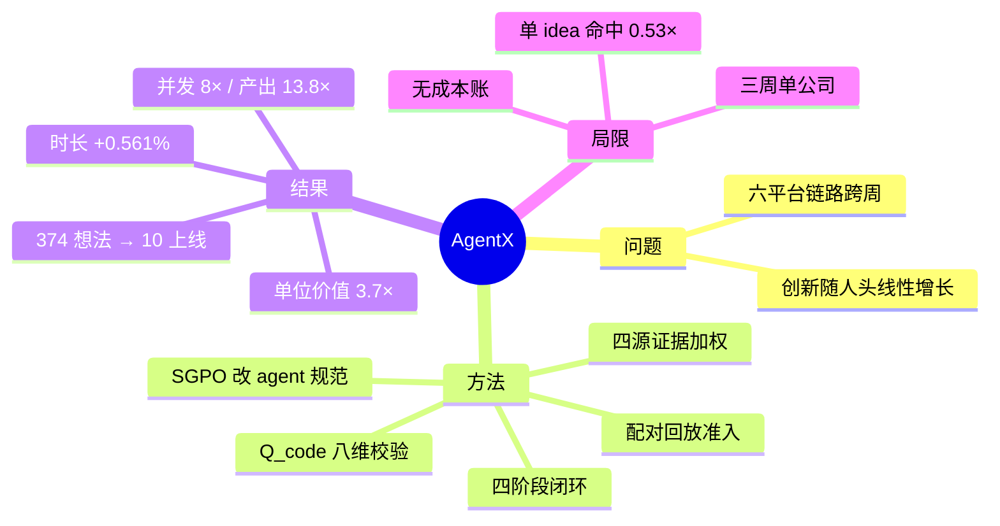
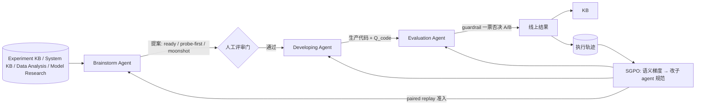

# AgentX：以 Agent 闭环重构推荐系统的生产迭代（arXiv:2606.26859）

> **英文标题**：AgentX: A Self-Evolving Multi-Agent System for Industrial Recommendation
> **作者 / 机构**：快手（Kuaishou）AgentX 团队
> **发表**：arXiv:2606.26859v2；技术报告体例，约 50 页
> **代码**：未开源
> **一句话**：把「想法 → 实现 → 上线 → 归因」整条生产链路交给四个 agent 的闭环，以真实线上 A/B 为奖励、以执行轨迹反向进化 agent 自身的规范（SGPO），三周内在快手主 feed 与生活服务上把 374 个想法变成 10 个可上线结果，单 worker 并发 8×、单位人力业务价值 3.7×。

## 思维导图

## 0. 三十秒速览

| 项 | 内容 |
|---|---|
| 解决什么问题 | 一次算法迭代要跨数据分析、特征、模型、上线、A/B、归因，依赖异构平台、发布周期以周计；创新随人头线性增长，而不是随证据与积累的实验知识复利 |
| 核心手段 | 四阶段闭环：Brainstorm（出提案，带 intake boundary / 三档成熟度 / avoid set / 四源证据加权）→ Developing（repository-grounded 生成 + 8 维 Q_code 校验）→ Evaluation（guardrail 一票否决的 A/B，成功失败都资产化）→ Harness Evolution（SGPO：把轨迹蒸馏成语义梯度改子 agent 规范，paired replay 准入） |
| 关键结果（生产） | 三周、3 个 worker、374 想法 → 106 通过 → 100 上线 → 10 个可上线结果；单 worker 并发 12 vs 工程师 1.5（8×）；单位人力业务价值 3.7×（Table 8） |
| 关键结果（业务） | 主 feed 用户消费时长累计 +0.561%；生活服务年化收入超 1 亿元；周并发 15→60、idea 通过率 15%→45%、周 LR 2→5（Figure 10） |
| 是否开源 / 是否上生产 | 未开源；已在快手 App 两条业务线上部署三周 |
| 我最该记住的一点 | 进化对象是 **agent 的规范（prompt/流程/输出契约）**，不是模型权重；证据是执行轨迹，准入门是 paired replay——这让能力可以跨实验继承而不退化 |

## 1. 摘要（忠实译述）

工业推荐系统的持续改进依赖一条「想法 → 实现 → 上线 → 归因」的迭代链路，但这条链路存在结构性执行瓶颈：生成假设、修改生产代码、发起 A/B、归因线上结果仍要依赖人类工程师。因此创新随人头线性增长，而不是随证据、算力与积累的实验知识复利。我们提出 AgentX，一个已生产部署的多 agent 系统，从根本上重构了这一生产函数。AgentX 作为自进化的开发引擎运行：它以任何人工流程都无法维持的规模与节奏，自主生成、实现、评估并学习推荐实验。系统在闭环中编排四个紧耦合阶段：Brainstorm Agent 把历史实验、系统架构、数据分析与外部研究四类证据综合成排序后的可执行提案；Developing Agent 通过「仓库接地」的生成与多维可靠性验证把提案转成生产可用代码；Evaluation Agent 在护栏一票否决的判定下做安全上线，并把成功与失败都转成结构化知识资产；Harness Evolution 层（SGPO）把执行轨迹蒸馏成语义梯度更新，持续打磨 agent 自身——使系统不只是自动化，而是自我改进。在为期三周、覆盖主 feed 与生活服务推荐的快手 App 部署中，三个 AgentX worker 把 374 个想法变成 10 个可上线结果：自进化使单 worker 吞吐每周翻倍，相对人工工程师实现 8 倍并发与 3.7 倍业务价值、0.561% 的用户使用时长提升，以及超过 1 亿元人民币的年化收入。

## 2. 核心贡献

1. **把生产迭代重构成四阶段闭环**（§3）：Brainstorm / Developing / Evaluation / Harness Evolution，每阶段都有明确的输入契约、失败处理与资产化出口。为什么重要：它不是把某一步自动化，而是让「想法供给」和「评测带宽」成为瓶颈，从而把人力从执行挪到选择。
2. **仓库接地（repository-grounded）的代码生成 + 多维可靠性验证**：属性必须先经 schema 工具查询才能使用，ranking DSL 由编译器级 checker 校验算子与实参，C++ 惯用法由轻量 linter 拦截；质量分覆盖 8 个维度（属性幻觉 22%、正确性循环 18%、人工介入 18% 权重最高）。为什么重要：工业代码的典型失败不是语法错，而是「能编译但静默失效」——编造字段、漏注册 factory、默认开启未套 feature switch。
3. **SGPO：以执行轨迹为证据的 harness 自进化**（§7）：把轨迹失败的自然语言诊断当作「语义梯度」，改写单个子 agent 的 instruction / 校验规则 / 输出契约 / 工具纪律，且**只允许通过 paired replay 准入**（同一批回放任务上新旧 harness 对比，赢了才合入）。为什么重要：这让 agent 能力可以跨实验继承，而不需要重训模型；同时把「自我修改」变成可回滚的离线系统优化问题。

## 3. 问题与动机

论文先指出推荐场景不满足三个经典 agent 假设（§1）：奖励在延迟的 A/B 里而不是即时环境反馈；单次部署要先过护栏与人工评审；优化目标本身随业务漂移。因此只能做闭环，不能做 one-shot。

真正的瓶颈是结构性的：一次完整迭代要跨数据分析、特征工程、模型、上线、A/B、归因，依赖异构平台，发布周期以周计（§1）。而最稀缺的能力——提出高质量假设、解释失败、指出优化方向——被拉数据、改配置、维护流水线稀释掉了。作者给出的判据很硬：现有 ML/科研 agent 缺三样东西——**真实线上反馈**（作为奖励信号）、**工业尺度验证**、**任务结束后不沉淀参数的持续进化机制**（§2）。

配套的一个观察值得记住：模型侧把「可信结论」定义为四个条件同时成立——机制与可观测量吻合、专家 agent 面板超多数同意、指标由原始日志确定性抽取、AUC 增益有因果链归因；没有归因的提升只当「刹车信号」而不是结论（§3.3）。这条定义直接决定了整个系统怎么避免自欺。

## 4. 方法

### 4.1 总体框架

闭环的关键是「所有阶段的产物都回流成下一轮的输入」：提案被拒要写进 avoid set、失败实验要进 failure memory、执行轨迹要供 SGPO 进化 agent 规范。

### 4.2 Brainstorm Agent

先把模糊意图规约成 **intake boundary**：目标、允许改动面、禁改项、护栏、未决问题——把不确定性显式化，而不是下传给下游（§3.1）。

提案按批探索并分三档成熟度：`ready-to-implement`、`probe-first`、`moonshot-backlog`。每轮把被拒方向、历史重复、越界机制写进 **avoid set**，下一轮只在剩余空间里搜——相当于残差式收缩可行域。

证据来自四个来源 $K=\{\text{Experiment KB},\ \text{System KB},\ \text{Data Analysis},\ \text{Model Research}\}$，按候选自适应加权 $\alpha_k(q,c)$（非负、和为 1）：

$$E(c\mid q)=\sum_k \alpha_k(q,c)\,e_k(c)$$

$$S=\lambda_o O+\lambda_b B+\lambda_f F+\lambda_h H+\lambda_e E-\lambda_r R$$

其中 $O,B,F,H$ 分别是机会、收益、可行性、健康度等维度分，$R$ 是风险惩罚（Eq. 1–4，§3.1）。System KB 是 `schema / wiki / raw-source` 三层结构化 wiki，靠 ingest–query–lint 维护；Model Research 把论文拆成带角色与证据强度的 claim、架构组件与论文间关系，并用生产 feature contract 与「流式增量、无 epoch、禁冻结 backbone/早停」等硬约束**在源头**裁掉不可行想法，而不是事后拿生产指标筛。

### 4.3 Developing Agent

分线上策略轨与离线模型轨（§3.2）。核心是 repository-grounded：属性必须先经 user/context/item schema 工具查询才可使用；ranking DSL 由编译器级 checker 校验算子与实参；C++ 惯用法由轻量 linter 拦截。流程是「计划 → 原子子需求 → 组装 → 确定性验证」，失败以定向修复而非整体重生成的方式反馈。

质量分 $Q_{code}=\sum_i \lambda_i s_i$ 覆盖 8 个维度，权重最高的三个是属性幻觉 22%、正确性循环 18%、人工介入 18%（三 S 级项合计 58%）。典型失败模式被明确列出：编造字段、漏注册 factory/queue、默认开启但没套 feature switch——都是「能编译、能跑、但静默失效」类问题。

### 4.4 Evaluation Agent

负责安全灰度与流量分配，做 **guardrail-vetoed 的 A/B 判定**：护栏指标一票否决，业务指标再好也上不了（§3.3）。成功与失败都被资产化为可复用奖励信号与 failure memory——这点与多数「只记成功」的系统不同。

### 4.5 Harness Evolution（SGPO）

SGPO = Semantic-Gradient-based Prompt Optimization。它把累积执行轨迹变成子 agent 规范的**局部更新**，且只通过 paired replay 准入（§7）。

- **SGPO-I（轨迹版）**：以会话轨迹为证据源；对目标子 agent $i$ 的当前规范 $h_{t,i}$，每轮采样一小批轨迹，做「loss 计算」得到语义梯度 $g_{t,i}$——它不是数值导数，而是对「缺了什么、哪里反复失败」的结构化诊断；再由 refinement agent 把 $g_{t,i}$ 转成新规范 $h'$；随后**立即在同一批 replay 任务上对比新旧 harness**，赢了才合入。
- **SGPO-II（编码回放版）**：证据源从对话轨迹换成代码回放案例（从历史 MR 构造 requirement-only 任务，隐藏已落地补丁），并先过滤噪声、过期、琐碎、批量改动；回放失败被总结成语义梯度继续迭代。

论文自己指出：SGPO 的曲线**不一定单调**，会出现暂时回退与噪声恢复；它的价值不是「每次更新都有提升」，而是「paired replay 能暴露退化，从而把坏更新挡在门外」（§7.3）。

## 5. 实验与证据

### 5.1 设置

| 维度 | 内容 |
|---|---|
| 部署 | 快手 App 主 feed + 生活服务，三周；3 个 AgentX worker |
| 业务指标 | 用户消费时长、年化收入；护栏指标一票否决 |
| 效率指标 | 单 worker 周并发实验数、周可上线结果数、单位人力业务价值 |
| 对照组 | 同一组织内一位算法工程师的传统手工迭代流程（Table 8） |
| 附加研究 | 模型研究侧的论文复现 + 跨论文架构组合（独立实验池，不与主实验的节点数直接可比，§8.2） |

### 5.2 主结果

**想法漏斗**（Table 5）：374 个想法 → 通过 106（28.34%）→ 代码与上线 100（94.3%）→ 评估为正 10（9.9%）；端到端 10/374 ≈ 2.67%，平均每 worker 3.3 个。

| 指标（每 worker·周） | AgentX | 工程师 | 倍数 |
|---|---|---|---|
| 并发实验数 | 12 | 1.5 | 8× |
| 可上线结果数 | 1.1 | 0.08 | 13.8× |
| 累计 app 时长增益 | 0.0623% | 0.0167% | 3.7× |
| 单 idea 上线转化率 | 2.7% | 5.1% | 0.53× |

解读（Table 8）：AgentX 在「量」上全面胜出，但在「单 idea 命中率」上只有工程师的 0.53 倍——作者自己也承认这一点，并把它解释为「人工想法是手挑、预筛过的」。也就是说，这套系统的本质是**用精度换吞吐**。

**业务结果**（§8.1）：主 feed 用户消费时长累计 +0.561%；生活服务年化收入超 1 亿元。三周内周并发 15→60、idea 通过率 15%→45%、周可上线结果 2→5（Figure 10）——吞吐与选择率同时上升，这是「自进化」最直接的证据。

**Showcase**（§9）：PCV 直接加权方案 $S_1=B_r(1+\beta P)$ 拿到人均时长 +0.034%、用户时长 +0.021%，但活跃设备 −0.023%、18–30 岁人均使用 −0.032%，被判「方向对但太噪」；第二轮改成约束式 $S_2=B_d(1+\beta(u)G(P))$、$G(P)=\max(P-\tau,0)$，得到用户时长 +0.071%、real-show +0.118% 且护栏稳定。这条链完整展示了「失败被资产化后成为下一轮输入」。

**模型研究侧**（§8.2）：在 RankMixer 上复现 8 篇方法、四个公开数据集共 32 个可训练变体；最优组合 MHFT+VQ_Code+MVSF 平均 +0.0264，工业数据上 MHFT +0.0151、MHFT+HSTU+MVSF +0.0098，且公开集排名在工业数据上不完全保持。

### 5.3 证据边界

- **有支撑**：三周真实部署、两条业务线、有对照组的效率数据、有护栏判定的线上收益；漏斗每一级的转化率都有原始计数。
- **弱支撑**：「3.7× 业务价值」是「累计 app 时长增益/人力」推导出来的比值，不是同任务的直接对照实验；生活服务只有 13 个想法、2 个可上线结果，样本极小。
- **无支撑**：没有报告 LLM 调用成本、GPU 成本、人工评审工时，因此「更便宜」未被证明；SGPO 的长期稳定性只有 8 轮曲线，作者自己说非单调；「知识库腐化」风险没有量化（§10）。

## 6. 深度分析

### 6.1 为什么可能有效（机制层）

三个机制各自堵一个漏洞：**Brainstorm 的证据加权 + avoid set** 解决「提案重复、越界」，让 374 个想法里 28% 能过评审；**repository-grounded 生成** 解决「能编译但静默失效」，把上线转化率抬到 94.3%；**SGPO** 解决「经验不沉淀」，让吞吐每周翻倍。合起来的效果是「想法供给」与「评测带宽」成为新瓶颈——这正是论文标题里 production function 重构的含义。反过来看，若只做其中一条，最可能的结果是：想法多了但代码过不了评审，或者代码能跑但方向重复。

### 6.2 可疑之处

1. **对照组只有一位工程师**：8×/13.8× 的分母是「一位算法工程师的传统流程」，没有团队级对照；而且并发数、LR 数、价值都是不同量纲的比值，容易被拼成「全面碾压」的叙事。
2. **精度换吞吐被轻描淡写**：单 idea 转化率 0.53× 意味着一个想法被验证有效的概率只有人工的一半，真正的成本账要算「单位有效结果的总成本」，而论文没给成本。
3. **人工闸门仍在**：提案要过人工评审、A/B 实验仍由人创建、桶扫描每次重跑，「最少人工救援」是设计目标而非既成事实（§10 自述）。
4. **三周窗口太短**：自进化曲线在 3 周内是「每周翻倍」，但这类曲线的常见形态是早期陡升、后期平台；论文没有给出更长周期的数据，也没有给出「翻倍停止后」的行为。
5. **模型研究侧的结论弱**：公开集排名在工业数据上不保持，说明「用公开集选出的最优组合」未必能迁移；论文只用一句话带过，没有分析原因。

## 7. 与同族工作对比

| 工作 | 核心差异 | 相对优势 | 相对短板 |
|---|---|---|---|
| 本文 2606.26859 | 四阶段生产闭环 + SGPO 改 agent 规范 | 端到端含上线与归因；能力可跨实验继承 | 单公司三周；无成本账；精度让位于吞吐 |
| AgentX-Model 2609.30001（同族下一代） | 双 agent 只做模型研究，四类动作 + 谱系 | 单实验内的接续与证据留存更细 | 不含上线链路；不涉及策略侧 |
| Auto-RecSys 2609.10922（Meta） | 异步并行 + 跨服务器记忆 + 双环 | 多日作业的工程可靠性更强 | 无模型效果与线上证据 |
| 自进化 YouTube 2602.10226（Google） | 快慢双环按反馈延迟分层 | 线上 A/B 数字更完整、有成本（$20k token） | 无 harness 自进化；实验吞吐提升来自编排 |
| Astar 2608.27287（阿里+浙大） | 把「方向提议」训成专用小模型 | 提议质量可量化（S@1 0.6786） | 强绑定单系统；无端到端上线闭环 |

> 对比只基于机制定位；其余各篇的具体数字本笔记未逐一复核原文。

## 8. 可迁移 / 复现要点

1. **先把「失败资产化」做起来**：每条被拒提案写清「为什么拒、哪个约束越界」，每条失败实验写清「哪个指标掉了、护栏是否触发」。这些是 avoid set 与 failure memory 的原料，也是 SGPO 的证据源。
2. **给代码生成加「查询前置」**：任何属性必须经 schema 工具查过才能用，禁止模型直接写字段名。这一条能消灭大部分「能编译但静默失效」的问题。
3. **用 paired replay 管住自我修改**：任何 prompt/流程改动，都先在固定回放集上跑新旧对比，赢了才合入。成本低、可回滚，是防止「越改越差」的关键。
4. **验收口径要区分「量」和「质」**：同时报「单位人力产出」和「单 idea 命中率」，否则很容易用吞吐掩盖质量下降。

## 9. 局限与未解决问题

- **作者自述**：全自动并未打满——human approval gate、A/B 实验仍需人工创建、桶扫描每次重跑；SGPO 曲线非单调，稳定性证据有限；效果依赖私有 Experiment/System KB 与 feature contract 的质量，知识库腐化风险未量化（§10）。
- **我读出的**：缺少成本核算（token/GPU/评审工时）；三周窗口无法判断长期稳态；「单 idea 命中率 0.53×」意味着系统更适合「广撒网」场景，而非「稀缺专家方向」；生活服务 13 个想法的样本不足以支撑结论。
- **值得做的后续**：① 用同一批想法做「agent 全流程 vs 人工全流程」的配对实验，直接测单位有效结果成本；② 把 SGPO 的 replay 集做成持续增长的回归集，观察 3 个月后的退化率；③ 研究「何时该切换到人工」的路由策略——本文是全自动，但数据显示人工在精度上仍有优势。

## 10. 术语表

| 术语 | 含义 |
|---|---|
| intake boundary | 提案前把目标、允许改动面、禁改项、护栏显式化的边界文档 |
| avoid set | 记录被拒方向、历史重复、越界机制的负向清单，用于收缩搜索空间 |
| repository-grounded | 代码生成必须基于仓库/schema 的实时查询，而非模型记忆 |
| $Q_{code}$ | 8 维代码质量分，属性幻觉/正确性循环/人工介入权重最高 |
| guardrail-vetoed A/B | 护栏指标一票否决的线上判定 |
| SGPO | Semantic-Gradient-based Prompt Optimization，用轨迹诊断改 agent 规范 |
| paired replay | 新旧 harness 在同一批回放任务上的对照准入机制 |
| LR | Launchable Result，可上线结果 |

## 11. 原文定位

| 内容 | 位置 |
|---|---|
| 三假设不成立与闭环理由 | §1 |
| 四阶段总览 | §3、Figure 2 |
| Brainstorm 打分与证据加权 | §3.1、Eq. 1–4 |
| Developing 与 $Q_{code}$ 权重 | §3.2 |
| 可信结论四条件 | §3.3 |
| Evaluation 与护栏否决 | §3.3 |
| SGPO-I / SGPO-II | §7.1、§7.2、Figure 7–9 |
| 想法漏斗 | Table 5、Eq. 10 |
| 生产率对照 | Table 8 |
| 三周自进化曲线 | Figure 10、§8.1 |
| Showcase（PCV S1/S2） | §9 |
| 模型研究侧 | §8.2 |
| 局限与教训 | §10 |
