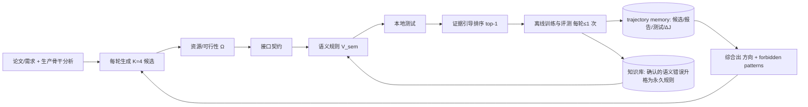

# NOVA：面向工业推荐架构演化的验证感知 Agent Harness（arXiv:2606.27243）

> **英文标题**：NOVA: A Verification-Aware Agent Harness for Architecture Evolution in Industrial Recommender Systems
> **作者 / 机构**：Shaohua Liu、Liang Fang、Yilong Sun、Shudong Huang 等 19 人 / 腾讯（Tencent Inc.）
> **发表**：arXiv:2606.27243v3，2026-07-28；含附录（规则审计表、变体清单）
> **代码**：未开源
> **一句话**：把「改生产推荐架构」做成固定评测预算下的多轮候选搜索，训练前先用领域语义规则拦掉「能跑但非法」的改动、再把语义诊断/本地测试/离线 ΔAUC 蒸馏成修改方向与禁用模式，EPR 53.3%（ScaleUp）/51.7%（文献落地），线上 5% 流量 GMV +1.25%~+2.02%。

## 0. 三十秒速览

| 项 | 内容 |
|---|---|
| 解决什么问题 | 生产架构改动要同时满足拓扑/特征/交互的接口、资源、serving 约束，专家贵、A/B 只能试少量方案；通用编码 agent 只验「能跑」，会犯语义静默失败（特征-token 错位、序列 mask 缺失、辅助损失索引错配、目标泄漏） |
| 核心手段 | 每轮生成 K=4 个满足生产约束的候选 → 四层验证（资源/接口/语义规则/本地测试）→ 证据引导排序 → 每轮最多 1 次离线评测；跨轮把诊断与结果写成方向 + forbidden patterns，确认的语义错误升格为永久规则 |
| 关键结果（离线） | 同预算下 EPR 最高：ScaleUp 53.3%、Literature-to-Production 51.7%，比最强自动化基线 R&D-Agent（29.2%/28.3%）高 24.1/23.4pp（Table 1） |
| 关键结果（线上） | 5% 流量 6 天 A/B：三个 pCVR 目标 GMV +1.25%/+1.70%/+2.02%，绝对偏差相对下降 58.8%/66.7%/37.3%（Table 4） |
| 是否开源 / 是否上生产 | 未开源；已做 5% 流量生产 A/B，计划全量 |
| 我最该记住的一点 | 「能跑 ≠ 合法」必须是训练前的显式门禁；把语义失败沉淀成带 source/scope/condition 的规则库，性价比最高（去掉语义验证 EPR 掉 30.5pp） |

## 1. 摘要（忠实译述）

工业广告推荐系统靠架构改动持续改进，但生产迭代仍然是专家密集型的：模型拓扑、特征配置、交互模块的协同修改必须满足严格的接口、资源与 serving 约束。AutoML 被限制在预定义搜索空间内，而通用编码 agent 验证的是「能否运行」而不是推荐系统特有的语义合法性。因此，可执行的候选可能违反架构契约；同时，语义诊断与评测结果缺乏结构化复用，会导致反复做无效或低效的修改。我们提出 NOVA，一个验证感知的 agent harness，把生产架构修改组织成固定评测预算下、针对具体实现的多轮搜索。每轮 NOVA 在生产约束下生成多个候选，拒绝语义违规者，并对有效存活者排序以进入本地测试与离线评测。跨轮时，trajectory memory 把语义诊断、本地测试结果与离线指标变化综合成修改方向与禁用模式，用于引导后续搜索。在自动化方法的最大离线评测预算相同的前提下，NOVA 取得最高有效通过率：ScaleUp 任务 53.3%，文献落地（Literature-to-Production）任务 51.7%。在覆盖 5% 流量、服务超过十亿用户的生产广告系统 A/B 中，选中的文献落地方案在三个主要 pCVR 目标上分别带来 +1.25%、+1.70%、+2.02% 的 GMV 提升，对应的绝对 pCVR 偏差相对下降 58.8%、66.7%、37.3%。

## 2. 核心贡献

1. **把「架构修改」形式化成带约束的多轮候选搜索**：架构状态 $A_t=(G_t,\phi_t,F_t)$（计算图 / 特征配置 / 结构超参），每轮在约束集 $\Omega$ 下生成 $K=4$ 个候选；每轮至多一次离线评测，从而让不同方法的「最大离线预算」可比（§4）。为什么重要：没有预算对齐，「agent 比 AutoML 好」这种结论无法成立。
2. **四层验证 + 训练前语义门禁**：资源可行性（shape/dtype/参数量与 FLOPs 预算）、接口契约、语义契约 $V_{sem}$（规则库三源）、可执行性（本地测试）。为什么重要：语义非法与「合法但 AUC 不涨」被明确分开，后者只能靠评测发现，前者可以在训练前零成本拦下（§4.3）。
3. **trajectory memory 与规则升格**：每轮的（候选、语义报告、本地测试、$\Delta J$）入档，被拒候选以 $\bot$ 记录；综合出 $z=(\text{弱组件归因},\text{修改方向},\text{forbidden patterns})$；离线结果与预期不符时回查代码，确认的语义错误**升格为永久规则**（§4.4）。为什么重要：这是让 harness 跨任务积累的机制，也是它与「一次性代码生成 agent」的分水岭。

## 3. 问题与动机

生产推荐的每次架构迭代都要同时改模型拓扑、特征配置和交互模块，并守住接口/资源/serving 三条线（§1）。作者把现有做法的问题归成两类：

1. **搜索空间受限**：AutoML / NAS / HPO 只在预定义空间里搜标量或算子，无法表达跨模块的接口与资源约束，也搜不出结构性的新组合。
2. **验证太浅**：通用编码 agent 只要编译通过、shape 对就认为成功，于是出现 *semantic silent failure*——特征与 token 映射错位、序列 mask 缺失、logit 融合路径错误、目标泄漏、辅助损失索引与目标错配。这类错误代码能跑、甚至能训，但结论无意义。

论文还明确指出一个容易被忽略的划分：**语义非法**（训练前可判）与**合法但 AUC 不涨**（只能靠离线评测发现）是两类失败，必须分别治理；而这两类失败如果不结构化沉淀，团队就会反复踩同一个坑。

## 4. 方法

### 4.1 总体框架

约束集 $\Omega$ 里最典型的例子是 ScaleUp 任务：总规模必须落在基线 ±10%，且 `token_dim` 必须整除 `token_cnt`——后者来自 tokenization 与交互设计的耦合，不是超参问题而是结构约束（§5.4）。

### 4.2 四层验证

1. **资源/可行性**：tensor shape、dtype、特征可用性、参数与 FLOPs 预算。
2. **接口契约**：特征 schema 与实现是否对位、token 分组语义、训练与 serving 接口兼容。
3. **语义契约 $V_{sem}$**：规则集 $L_t$ 有三个来源——论文要求、前几轮确认的语义错误、知识库中已验证的规则；每条规则记 `source / scope / condition`，输出 pass/reject、违规规则与代码位置。论文给的典型规则包括：同一 token 内特征须语义一致；每个辅助损失必须使用其设计目标的预测/标签索引；需要 item-item 交互时不允许用 token-wise MLP 取代 self-attention（Table 6）。
4. **可执行性**：本地测试兜住编译与 shape 错误；LLM 只读结构化状态与错误摘要，不直接读日志洪水（§4.3）。

### 4.3 评估指标 EPR

主指标是有效通过率（Effective Pass Rate），把一轮的结果拆到漏斗各阶段：

$$\text{EPR}=\frac{N^{+}_{\text{AUC}}}{N_{\text{iter}}}$$

其中 $N^{-}_{sem}$ 计「本轮 4 个候选全被语义判非法」的轮数、$N^{-}_{local}$ 计选中候选本地测试失败的轮数、$N^{-}_{eff}$ 计进入离线评测但未过 AUC-positive 阈值的轮数、$N^{+}_{AUC}$ 计产出 AUC-positive 候选的轮数（§5.1）。配套的失败率 $SFR_{sem}$、$LFR$、$SFReff$ 把失败按阶段归因。关键设计：所有方法的 $SFR_{sem}$ 都用三位专家工程师独立审计后的多数票事后标注，而不是用 NOVA 自己的判定器——避免了「自己判自己」。

实验协议：每设定 20 个任务、$R_{max}=10$ 轮、$\tau=0.15$pp、AUC-positive 定义 $\Delta AUC\ge 0.10$pp、$N_{iter}\le 200$（§5.2）。

### 4.4 trajectory memory 与知识升格

每轮记录 $(\text{候选}, \text{语义报告}, \text{本地测试}, \Delta J)$；被拒候选以 $\bot$ 入档，语义合法但未选中的不入档（避免把「没试」当「不行」）。Memory 综合出 $z=(\text{弱组件归因}, \text{修改方向}, \text{forbidden patterns})$ 注入下一轮提示。当离线结果与预期改动不符时触发代码检查，若确认是语义错误则写入知识库、成为后续所有任务的永久规则；瞬时基础设施失败则忽略（§4.4）。任务开始时加载 KB 快照，任务内保持不变，保证同一任务内规则稳定。

### 4.5 工程形态

L1–L4 能力分级 + AutoRun / Copilot 双模式；LLM 推理与确定性脚本执行分离（脚本负责抽取、校验、评测提交，模型只做判断）（§4.5、§3）。这套分层让「同一个 harness 既能在无人值守下跑，也能让人在旁边接管」。

## 5. 实验与证据

### 5.1 设置

| 维度 | 内容 |
|---|---|
| 数据 | 一个月、十亿级交互、1000+ 特征域的生产广告数据；所有候选从头训练 |
| 任务 | L2 ScaleUp（生产 RankMixer 风格骨干上的结构性缩放）、L3 Literature-to-Production（把论文模块集成进生产骨干） |
| 基线 | R&D-Agent+Skills、ReAct+Skills、OpenHands+Skills、Optuna-TPE，外加**回溯性**人类专家参照 |
| 预算对齐 | 所有自动化方法的「最大离线评测次数」相同；LLM 推理成本未对齐（作者自述） |
| 线上 | 6 天用户随机 A/B，5% 流量，服务超十亿用户 |

### 5.2 主结果

| 方法 | ScaleUp EPR | 文献落地 EPR | 语义失败率 $SFR_{sem}$（L3） | 本地失败率 LFR |
|---|---|---|---|---|
| 人类参照（非预算匹配） | 49.2% | 31.0% | 16.9% | 4.6% |
| R&D-Agent + Skills | 29.2% | 28.3% | 19.6% | 37.5% |
| ReAct + Skills | 12.5% | 8.3% | 39.6% | 62.5% |
| OpenHands + Skills | 6.3% | 17.4% | 45.7% | 66.7% |
| Optuna-TPE | 5.2% | — | — | 82.8% |
| **NOVA** | **53.3%** | **51.7%** | **13.3%** | **1.7%** |

解读（Table 1）：NOVA 比最强自动化基线高 24.1pp / 23.4pp；本地失败率从基线的 37.5%–82.8% 降到 1.7%，说明「架构约束感知」把大量本该在训练阶段才暴露的错误提前拦下；人类参照 49.2%/31.0% 仅供参考，因为它不是同预算产物。

### 5.3 消融（L3，Table 2）

| 去掉的组件 | EPR 变化 | 失败迁移方向 |
|---|---|---|
| 语义规则验证 | **−30.5pp** | 语义与有效性失败同时上升 |
| 证据引导排序 | **−40.3pp** | 主要转向离线无效（$SFReff$=51.4%） |
| trajectory memory + 结构化反馈 | **51.7% → 23.8%** | 说明「任务内基于轨迹迭代」是主要贡献，不是共享 skills |
| 知识库快照 | **−37.4pp** | 失败上移：$SFR_{sem}$ 47.6%，LFR 33.3% |
| Material Understanding | −15.3pp | — |
| Solution Design | −25.4pp | — |
| 多候选（K=1） | −16.9pp | 注：K=1 的语义失败率不可直接比较 |

最有信息量的是「证据引导排序」比「语义验证」掉得更多：说明在这个任务上，**从多个合法候选里挑对**比**拦住非法候选**更值钱——这和大家直觉里「先保证合法」的顺序相反。

### 5.4 案例与线上结果

Case 1 的六轮轨迹（Table 3）值得完整记住：Round 3 过了规则、也过了本地测试，但 $o_1$ 只 +0.08、$o_3$ −0.06，回查发现是**辅助损失索引错配**；Round 5 同时加 token MLP 与提高损失权重，三个目标全崩（−0.24/−0.06/−0.06），该组合被记为 forbidden；Round 6 回滚到 Round 4、只调权重，得到 +0.15/+0.02/+0.09。线上（Table 4）：$o_1$/$o_2$/$o_3$ 三个目标 GMV +1.25%/+1.70%/+2.02%，绝对 pCVR 偏差相对下降 58.8%/66.7%/37.3%，作者据此计划全量。

### 5.5 证据边界

- **有支撑**：同预算下 EPR 领先、LFR 大幅下降、消融显示轨迹反馈与排序是主要贡献；线上拿到了 GMV 与偏差双指标的正向结果。
- **弱支撑**：人类参照是回溯的、非预算匹配，不能当作「agent 超过资深工程师」的证据；消融只在 L3 上做，L2 没有对应消融。
- **无支撑**：LLM 推理成本未对齐（作者自述），因此无法判断「同等算力下」是否仍领先；语义规则库的完备性没有理论或统计保证——Case 1 Round 3 的错误恰恰不在当时的活跃规则集内；此外仍有 13.3% 语义失败与 23.3% 离线无效。

## 6. 深度分析

### 6.1 为什么可能有效（机制层）

收益来自三个不同层面，混在一起会看错：**约束感知**（把 `token_dim | token_cnt` 这类结构耦合写进生成阶段，直接消灭大量 LFR）；**验证前置**（语义门禁把「训完才发现无效」的成本挪到训练前，等于把昂贵评测的样本效率拉高）；**经验结构化**（forbidden patterns 让同一失败不重复，$z$ 让下一轮从「已确认的弱组件」出发）。三者合起来解释了为什么 EPR 能从 29.2% 跳到 53.3%，而单纯换更强的编码 agent（OpenHands/ReAct）几乎没用——它们缺的是第 2、3 层。

### 6.2 可疑之处

1. **预算只对齐了评测次数**：LLM 推理成本未对齐，而 NOVA 每轮要 4 个候选 + 四层验证 + 4 裁判排序，token 消耗大概率远高于基线；「同预算」这句话容易被误读成「同成本」。
2. **语义规则库靠人/模型共同增补，存在「事后诸葛」风险**：Case 1 的错误在发现后才变成规则，若用同一批任务做评估，规则库相当于见过测试集；论文没有报告「在新任务上、规则库冻结」的冷启动表现。
3. **排序用了 4 个外部 LLM 当裁判**（GPT/Claude Opus/Gemini/Kimi，五维固定权重、裁判等权平均），权重从哪来、是否在本任务上调过，正文没给消融；这类「裁判委员会」在生产上还意味着额外延迟与供应商依赖。
4. **线上只报正向**：5% 流量 6 天、三个目标 GMV 全为正，但没有给置信区间、也没有报负向指标（如多样性、长期留存），而架构级改动的风险通常体现在这些地方。
5. **场景只有广告 pCVR**：结论能否迁移到召回/排序/多目标融合的其他环节未知；L2 任务本质上更接近「结构性超参」，用它证明「架构演化」有点弱。

## 7. 与同族工作对比

| 工作 | 核心差异 | 相对优势 | 相对短板 |
|---|---|---|---|
| 本文 2606.27243 | 验证优先 + 失败模式沉淀 + 固定评测预算的 EPR 口径 | 语义合法性作为训练前门禁；指标口径可复现 | 规则库完备性无保证；推理成本未对齐 |
| RecHarness 2607.29241（GT+快手） | 用 bandit 在修改方向上路由 | 方向选择的探索-利用有理论框架 | 不做训练前语义验证，实现层失败率高 |
| Astar 2608.27287（阿里+浙大） | 训练专门的「方向提议」模型 | 方向提议可学习、可复用 | 同样弱在实现级校验与失败模式复用 |
| AgentX 2606.26859（快手） | 四阶段生产闭环，覆盖上线 | 端到端、含部署闸门 | 单实验内的语义校验粒度粗 |

> 对比只基于各文机制定位；其余三篇的具体数字本笔记未逐一复核原文。

## 8. 可迁移 / 复现要点

1. **先写「非法清单」再谈搜索**：把团队踩过的语义错误整理成 `rule_id + source + scope + condition + 检查方式` 的表，作为生成阶段的硬约束。复现成功判据：新手写出的改动里，语义失败率显著低于无规则基线。
2. **把失败分阶段计数**：照 EPR 的漏斗（语义/本地/离线/有效）统计，而不是只报最终通过率。这样能立刻看出瓶颈在「不会写」还是「写不对」还是「写了没用」。
3. **forbidden patterns 要能回滚到具体轮次**：Round 5 的教训之所以可复用，是因为它记下了「哪个组合 + 哪三个目标的 Δ」，而不是一句「别这么干」。
4. **验收加一个正确性指标**：本文用 pCVR 偏差与 GMV 并列；任何推荐系统改动都可以配一个「偏差/校准」类指标，避免「指标涨、系统坏」。

## 9. 局限与未解决问题

- **作者自述**：只对齐了最大离线评测预算，LLM 推理成本未对齐；人类参照是回溯的、非预算匹配；语义规则由 LLM 判定并持续增补，完备性无保证；选择目标仅为离线 AUC 阈值，且对请求的具体性敏感（§5.8）。
- **我读出的**：规则库的冷启动与「见过测试集」效应没有被评估；4 裁判排序的权重与稳定性没有消融；线上只报正向、缺置信区间与风险指标；L2 任务偏「结构性调参」，不足以支撑「架构演化」这个大词。
- **值得做的后续**：① 在新任务上冻结规则库做一次冷启动评估，量化规则迁移价值；② 把「每轮 token 成本」纳入预算对齐，给出 EPR/美元的对比；③ 对 forbidden patterns 的命中率做统计——如果大部分被拦的候选本来也会失败，机制就只是省了评测钱，而不是提升了搜索质量。

## 10. 术语表

| 术语 | 含义 |
|---|---|
| EPR | Effective Pass Rate，有效通过率，一轮产出 AUC-positive 候选的比例 |
| $SFR_{sem}$ / LFR / $SFReff$ | 语义失败率 / 本地测试失败率 / 离线无效失败率，三者把失败按阶段拆分 |
| $V_{sem}$ | 语义验证器，按规则库 $L_t$ 判定候选是否违反语义契约 |
| 语义静默失败 | 代码能跑、能训，但语义错误导致结论无意义的失败 |
| forbidden patterns | 从失败轨迹中蒸馏出的「禁止组合」清单 |
| 规则升格 | 确认的语义错误从「个案」变为知识库中的永久规则 |
| ΔAUC-positive | $\Delta AUC\ge0.10$pp，本文判定「有效」的阈值 |
| RankMixer | 本文生产骨干的架构名；ScaleUp 任务在其上做结构缩放 |

## 11. 原文定位

| 内容 | 位置 |
|---|---|
| 架构状态与候选生成 | §4.1–§4.2 |
| 四层验证 | §4.3、Table 6 规则示例 |
| EPR 定义 | §5.1 |
| 主结果对比 | Table 1（§5.4） |
| 消融 | Table 2（§5.5） |
| 六轮案例 | Table 3（§5.6） |
| 线上 A/B | Table 4（§5.7） |
| 部署教训与局限 | §5.8 |
| 部分变体清单 | Table 7、Table 8 |
