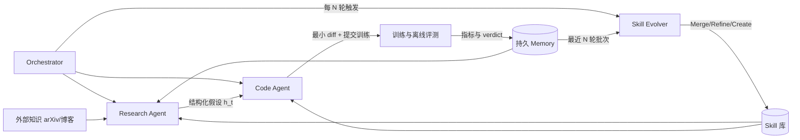
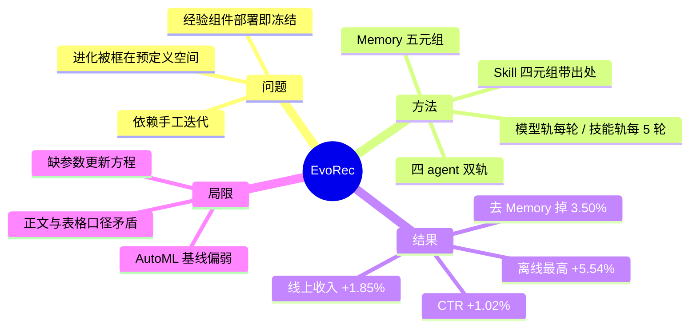

# EvoRec：模型与方法论双轨自进化的多智能体推荐优化框架（arXiv:2606.28368）

> **英文标题**：EvoRec: Self-Evolving Agentic Recommender Systems
> **作者 / 机构**：Lingyu Mu、Hao Deng（共同一作）等 6 人 / 阿里巴巴国际数字商业集团
> **发表**：arXiv:2606.28368v1，2026-06-15；6 页正文，无附录；页眉仍是 ACM 模板占位（Conference'17），未标注投稿去向
> **代码**：未开源
> **一句话**：四个 agent 组成双轨自进化闭环——每轮改模型、每 5 轮把实验轨迹蒸馏成可复用 Skill，离线最高 +5.54%，线上收入 +1.85%、CTR +1.02%。

## 0. 三十秒速览

| 项 | 内容 |
|---|---|
| 解决什么问题 | 推荐模型优化靠工程师手工迭代，慢且天花板是个人经验；现有 agent 方案只当代码翻译器、经验组件部署即冻结、进化被框在预定义搜索空间内 |
| 核心手段 | 4 个 agent（Orchestrator / Research / Code / Skill Evolver）+ 结构化持久 Memory + 可进化 Skill 库；模型轨每轮进化，技能轨每 N=5 轮进化一次 |
| 关键结果（实验/离线） | Books 与工业集共 16 个指标格全部最优；相对最强基线最大 +5.54%（Books N@10，0.0361→0.0381），最小 +2.23%（Industry 生成式 N@5） |
| 关键结果（线上/生产） | 东南亚电商广告平台 7 天 A/B：广告收入 +1.85%、CTR +1.02%，双侧检验 p<0.05，每组 20% 用户 |
| 是否开源 / 是否上生产 | 未开源；离线两个基座、线上单平台单场景 A/B 通过 |
| 我最该记住的一点 | 把「怎么调」写成带 evidence 指针的四元组 Skill 并周期性蒸馏——这是它与「一次性代码生成 agent」的唯一实质区别 |

## 1. 摘要（忠实译述）

现代推荐系统的优化仍严重依赖工程师手工迭代，速度慢，且受个人专业水平限幅。基于 LLM 的 agent 打开了自动化这一循环的路径，但既有做法只把 agent 当作代码翻译器、不积累任何方法论，并把搜索限制在预定义空间内，很少引入结构性的新想法。我们提出 EvoRec，一个让推荐模型与驱动它的优化方法论共同进化的多智能体框架。四个协作 agent 执行双轨循环：Research Agent 与 Code Agent 每轮迭代模型，Skill Evolver 周期性从持久 Memory 中过去的实验里蒸馏出可复用的方法论。在一个公开基准与一个大规模工业数据集上的实验表明，EvoRec 相对最强基线把离线指标最高提升 5.54%。一次线上 A/B 测试进一步带来 1.85% 的收入提升与 1.02% 的 CTR 提升，显示出替代传统人工优化流程的潜力。

## 2. 核心贡献

1. **双轨自进化（模型轨 + 技能轨）**：模型每轮都改，方法论每 N 轮才改，两轨只通过 Memory 耦合。为什么重要：一次性代码生成 agent 的产物只是「一个更好的模型」，而这里的产物还包括「一套下次还能用的调参规则」；前者换任务即归零，后者是可累积资产。原文把这种交替更新写成全局状态 $\langle\theta^{t-1}, S_t, M_t\rangle$ 的推进（§2.3）。
2. **把方法论形式化成可检索、可溯源的四元组**：$s=\langle\text{name}, \text{scope}, \text{content}, \text{evidence}\rangle$，其中 evidence 直接指回 Memory 条目编号（原文样例：Skill #12 标注「Evidence: Memory entries m14, m18, m22」）（§2.5）。为什么重要：这让「某轮为什么这么改」可审计，工业落地时比黑箱 prompt 记忆更容易被验收。
3. **公开集 + 工业集 + 线上 A/B 三层证据**：两个基座（ID 类 MGUI、生成式 REG4Rec）各派生一个 Evo 变体，16 个指标格全部最优，且线上拿到了收入级指标（§3.2、§3.5）。为什么重要：多数 agent 自动优化工作止步于离线小数据，「广告收入」这类指标是能否上生产的分界线。

## 3. 问题与动机

作者把痛点拆成两段递进。第一段是行业现状：推荐系统已从协同过滤演化成多级流水线，每一级都由大量特征工程、结构设计与超参调优堆出来（§1），这个过程受工程师个人经验限幅，导致大片优化空间没被探索过（引 [4][8]）。第二段是 LLM agent 带来了希望但既有工作不够，具体三条缺陷（§1）：

1. **agent 参与太浅**：多数方法只让 agent 生成代码，优化方向仍由人指定，agent 的推理与规划能力被浪费（引 [5] OxygenREC、[16] Deep Research for Recommender Systems）。
2. **经验组件是静态的**：一些工作引入了 Skill 或 Memory 模块（引 [3] Mem0、[17] MemGPT、[29] Agent Skills），但部署后即冻结，同样的失败反复发生，成功的策略无法复用。
3. **进化空间被框定**：少数自进化工作（引 [2] Let the Agent Steer、[23] Self-evolving Recommendation System）只做预定义空间内的超参搜索，无法引入新方法。

由此提出三条设计目标：开放域探索（能引入结构性新方法）、无人干预运行（整条流水线由 agent 自治驱动）、经验自我改进（系统持续从自己的进化轨迹中蒸馏知识）。前两条同族已有零星尝试，第三条才是立意所在。

一个反直觉观察来自案例研究：50 轮中最有效的两轮不是开放式探索，而是由蒸馏技能触发的（第 27 轮 +2.31%、第 33 轮 +0.63%），而 Research 来源给出 4 成功 2 回退（Table 3）。作者据此认为蒸馏方法论比开放探索更可靠，证据强度见 6.2 第 3 条。

## 4. 方法

### 4.1 总体框架

EvoRec 是三件「会变的东西」（Model、Skill 库、Memory）加四个 agent。Orchestrator 维护全局状态、逐轮驱动 Research/Code 完成一轮模型优化，每 N 轮触发 Skill Evolver 更新技能库；一轮的完整轨迹被写成一条 Memory 记录。三个终止条件：达到 $T_{\max}$ 轮、连续 $k$ 轮无提升、或命中目标指标阈值。失败的轮次不被丢弃，而是带失败原因保留下来供技能蒸馏（§2.2）。

两条轨的频率不同：模型轨每轮闭环一次，技能轨每 N 轮才闭环一次——跨轮归纳需要足够样本，否则会把噪声固化成方法论。

### 4.2 模型自进化轨：Research Agent 与 Code Agent

每轮开始时全局状态是 $\langle\theta^{t-1}, S_t, M_t\rangle$，分别是当前模型参数、技能库、记忆库（§2.3）。Research Agent 从外部知识源 $K_{\text{ext}}$（arXiv、技术博客）检索候选方向，与本轮匹配的 Research 类技能、Memory 中的历史成败案例一起加权，采样出本轮假设：

$$h_t \sim \pi_R(\cdot \mid K_{\text{ext}}, S_t, M_t) \tag{1}$$

其中 $h_t=\langle\text{motive}, \text{target\_module}, \text{expected\_gain}\rangle$ 是优化动机、待改模块与预期增益三元组。生成前还有一道多样性约束检查，避免连续多轮只改同一个模块而陷入局部最优；检索 $M_t$ 用于避开已失败方向，注入 $S_t$ 用于偏向已验证有效的探索模式（§2.3.1）。

Code Agent 把 $h_t$ 变成可执行实验：定位相关代码，调用 Engineering 类技能生成最小 diff 改动，提交训练任务，回收日志与指标得到本轮结果 $r_t$；若实现阶段判定假设不可行，就返回拒绝信号让 Research Agent 换假设。失败运行被标注失败原因后保留（§2.3.2）。

⚠️ 这里有个结构性缺口：原文给了假设采样方程，也给了记忆写入方程，但**没有给出模型参数的更新方程**。按正文描述，$\theta^t$ 的更新等价于「用 agent 改过的代码按原论文超参重训一次」。这既不是搜索算法也不是元学习，读者无法从中复现「进化」的具体算子，只能复现调度逻辑。

### 4.3 技能自进化轨：Skill Evolver 与持久 Memory

Memory 是经验中枢，每条记录是五元组：

$$m_t=\langle h_t,\ \Delta c_t,\ \log_t,\ \text{metric}_t,\ \text{verdict}_t\rangle \tag{2}$$

即假设、代码改动、训练日志摘要、离线指标向量、归因标签，其中 $\text{verdict}_t\in\{\text{success},\text{fail},\text{neutral}\}$。写入时抽取 target_module、verdict、metric_delta、timestamp 建倒排索引，支持字段级精确过滤；Memory 本身不参与进化，是纯被动存储（§2.4）。

技能蒸馏每 N 轮触发一次。Skill Evolver 取最近 N 轮记录作为批次，并按 verdict 做平衡过滤，让 success / fail / neutral 以预设比例 $\rho$ 出现，以保证既抽正面模式也巩固失败教训：

$$B_t=\{m_\tau \in M_t \mid t-N+1 \le \tau \le t\} \tag{3}$$

然后由策略 $\pi_E$ 生成 K 个候选补丁 $C_t=\{c_1,\dots,c_K\}\sim\pi_E(\cdot\mid B_t,S_t)$（Eq. 4）。每个候选先算与现有库的最大相似度 $\sigma_k=\max_{s\in S_t}\text{sim}(c_k,s)$，再按阈值 $\tau_c$ 走三种算子（§2.5.2）：Merge（批次内彼此相似度高于 $\tau_c$ 的候选先合并，避免一次引入冗余）、Refine（$\sigma_k\ge\tau_c$，与原技能合并且修订）、Create（$\sigma_k<\tau_c$，作为新技能入库）：

$$S_{t+1}=(S_t\setminus S_{\text{refined}})\cup S'_{\text{refined}}\cup S_{\text{new}} \tag{5}$$

技能按功能分三类：Research（指导假设生成）、Engineering（指导代码实现）、Diagnosis（指导失败修复，主要从 verdict=fail 蒸馏）。Orchestrator 按 scope 与当前目标的匹配度只注入相关条目。原文给了一个完整技能样例：Skill #12 的 scope 是「召回进入平台期时的采样策略」，content 规定「当 R@10 连续 ≥3 轮停滞，把随机负采样换成流行度加权难负样本，$\tau\in[0.05,0.15]$，从 0.1 起按训练损失方差调整」，evidence 指回 m14/m18/m22（§2.5）。

⚠️ 三处未定义：$\text{sim}(\cdot)$ 的具体度量没给（只给阈值 $\tau_c=0.6$）；$\rho=(0.5,0.3,0.2)$ 没说明三个数分别对应哪个 verdict 顺序；技能库最终规模没报，只在 Fig. 1 里画了 Skill-01 到 Skill-17 的示意。

### 4.4 训练与运行流程

1. **数据准备**：Amazon Books 过滤到交互数 ≥5 的用户；工业集为该东南亚电商平台 2026 年 1–5 月的内部交互日志，约 2.95B 用户—物品交互、14.7M 用户、20.1M 物品（§3.1.1）。两者都用留一法评估。
2. **训练**：所有模型 PyTorch 实现，4 张 NVIDIA A100；两个基座 MGUI 与 REG4Rec 的训练超参沿用各自原论文，EvoRec 只改代码不动这些默认值（§3.1.3）。四个 agent 共享 Claude Opus 4.6 作推理主干，配置为 $N=5$、$T_{\max}=50$、$k=10$、$\tau_c=0.6$、$\rho=(0.5,0.3,0.2)$。
3. **迭代**：单次运行迭代 50 轮（案例与 Table 3 的口径），每轮一次完整训练加离线评测；每 5 轮蒸馏一次，50 轮里理论触发 10 次。
4. **线上部署**：把 EvoRec-MGUI 产出的最终模型替换线上 MGUI，跑 7 天 A/B，实验组与对照组各随机 20% 用户，看广告收入与 CTR（§3.5）。注意线上只验证了 ID 类基座这一条路径。

## 5. 实验与证据

### 5.1 设置

| 维度 | 内容 |
|---|---|
| 数据集 | Amazon Books（用户交互 ≥5，过滤后规模原文未报告）+ 工业集（2.95B 交互 / 14.7M 用户 / 20.1M 物品，2026-01 至 2026-05） |
| Baseline | ID 类：SASRec、S3Rec、PinnerFormer、MGUI、Auto-MGUI；生成式：HSTU、TIGER、Cobra、REG4Rec、Auto-REG |
| 指标 | 留一法下 R@5 / R@10 / N@5 / N@10；线上：广告收入、CTR |
| 算力/预算 | 4×A100；LLM token 消耗、单轮墙钟时间、50 轮总成本均未报告 |

### 5.2 主结果

| 数据集 · 范式 | 组内最强基线 → EvoRec（R@10） | R@5 提升 | N@5 提升 | R@10 / N@10 提升 | 说明 |
|---|---|---|---|---|---|
| Books · ID-based | 0.0635（MGUI）→ 0.0664 | 4.15% | 4.93% | 4.57% / **5.54%** | 5.54% 是全文标题数字，出自 N@10（0.0361→0.0381） |
| Books · 生成式 | 0.0768（REG4Rec）→ 0.0792 | 2.70% | 4.18% | 3.13% / 3.48% | 增益最小的范式之一，基座本身已很强 |
| Industry · ID-based | 0.0547（MGUI）→ 0.0571 | 4.03% | 5.39% | 4.39% / 4.44% | 线上 A/B 用的就是这条路径 |
| Industry · 生成式 | 0.0736（REG4Rec）→ 0.0761 | 3.64% | 2.23% | 3.40% / 3.33% | 2.23% 是全文最小增益，出自 N@5（0.1302→0.1331） |

EvoRec 在两个数据集、两种范式、四个指标共 16 个格里全部最优，但提升幅度从 2.23% 到 5.54% 差了一倍多，说明「还能从基座里挤出多少」高度依赖基座与数据本身，而不是一个稳定的框架增益（Table 1）。原文全部用相对提升报数，没给多种子标准差或置信区间，因此「全部最优」在数值上成立，在统计显著性上只能算未检验。另需注意 Imp. 是按「组内最强基线」算的，个别格的最强基线并非基座本身：Industry 的 N@5 最强基线是 PFormer 的 0.0984，而不是 MGUI 的 0.0982，所以该格 5.39% 的分母不是 MGUI。

按绝对值看，工业集 ID 类基座 MGUI 的四指标是 0.0741 / 0.0982 / 0.0547 / 0.0736，EvoRec-MGUI 是 0.0775 / 0.1037 / 0.0571 / 0.0776（Table 1）；Books 上 EvoRec-MGUI 是 0.0527 / 0.0298 / 0.0664 / 0.0381。线上侧：7 天 A/B、实验组与对照组各 20% 用户，广告收入 +1.85%、CTR +1.02%，双侧检验 p<0.05（§3.5）。

### 5.3 消融与关键发现

- **去掉 Skill 进化（R@10 −2.10%，0.0571→0.0559）**：技能库冻结。注意 w/o Skill 组仍保留初始技能库，只是不再更新，所以这条消融衡量的其实是「周期性蒸馏的增量」，不是「有技能库」的价值（Table 2）。
- **去掉 Memory（R@10 −3.50%，0.0571→0.0551）**：三条消融里最大。系统没有历史记录时会反复探索已失败方向。这是全文最有信息量的一条——「不重蹈覆辙」比「总结方法论」更早、更直接地变现。
- **去掉外部知识（R@10 −1.58%，0.0571→0.0562）**：只靠内部经验时系统被限制在已知模式内，说明 arXiv/博客检索带来的是结构性新方向。但这项最小，且此时技能与记忆都在，不能把 5.54% 归功于外部知识。
- **50 轮轨迹（Table 3）**：最大单轮增益是第 27 轮 +2.31%（Skill #12 触发的难负样本挖掘，$\tau=0.1$），Skill #16 触发的第 33 轮 +0.63%；Research 侧第 19 轮多兴趣池化（4 头）+1.03%、第 24 轮 BCE 换 InfoNCE +1.18%，而第 11、36 轮分别回退 −0.82%、−0.87%。回退轮次被当作负例留在 Memory 里。
- **对「技能优于探索」的检验**：按 Table 3 的 Source 列数，Research 来源 6 轮（4 成 2 败）、Skill 来源 2 轮（2 成 0 败）。2 个样本支撑不了「蒸馏方法论比开放探索更可靠」这个结论（我的判断，见 6.2 第 3 条）。

### 5.4 证据边界

- **有支撑**：在固定 50 轮预算、固定基座、固定 LLM 主干下，两个 Evo 变体在两个数据集四指标上优于全部 10 个对照；技能/记忆/外部知识三件套移除任一都掉点且方向一致（Table 1、Table 2）；线上有正向的收入与 CTR 增量且 p<0.05（§3.5）。
- **弱支撑**：所有增益都是单次运行的相对提升，无标准差、无多种子、无显著性检验；消融只在工业集、只以 EvoRec-MGUI 为基座做了一遍；「换成 Qwen3.7-MAX 复现结论一致」只有一句话，没有数字也没有表（§3.1.3）；Books 过滤后规模未报，与文献中同名设定无法对齐，跨论文比这几行数字没有意义。
- **无支撑**：①「替代传统人工优化流程」——全文没有和「人类工程师在同等 50 轮内能调出什么」对照，也没有和贝叶斯优化/进化搜索在同等评估预算下比；②「第一个多智能体自进化优化框架」无法验证；③技能质量没有独立评估——没有误用率、没有错误技能的淘汰机制（算子只有 Merge/Refine/Create，没有 Delete 或降权）、没有库规模增长曲线；④成本——token 数、单轮训练时长、50 轮总开销一概未报，「省了人力」缺少分母。

## 6. 深度分析

### 6.1 为什么可能有效（机制层）

三个收益来源能把方法与结果模式对上：

1. **搜索空间的结构性差异**。AutoML 类基线被固定配置空间约束，而 Code Agent 直接产出代码 diff，能改的东西从超参扩到损失函数、采样策略、池化结构。Table 3 里 +1.18%（BCE→InfoNCE）与 +1.03%（4 头多兴趣池化）都发生在 AutoML 空间之外。这也是 Table 1 里 Auto-MGUI / Auto-REG 在多数格上打不过基座本身的直接原因——自动超参搜索在已经调过的生产模型上几乎没有剩余空间。
2. **失败记忆降低了无效重复**。去掉 Memory 掉 3.50%，是三个消融里最大的。在 50 轮预算下，最大的浪费不是「没想到好点子」，而是「把已证伪的方向又试一遍」；又因为每轮都要重训一个 2.95B 交互规模的模型，一次无效轮次的机会成本就是一整轮训练。
3. **技能把探索从「每轮重新想」变成「按条件触发」**。Skill #12 的形态（「R@10 连续 ≥3 轮停滞 → 换流行度加权难负样本，$\tau$ 从 0.1 起」）本质是一条带触发条件的策略补丁：它让 agent 在停滞信号出现时直接取用先验，而不是在无穷多可行方向里再采样一次。这也解释了第 27 轮的单轮增益（+2.31%）为何明显大于任何 Research 轮——它不是新探索，而是把此前采样实验的结论复用到了正确时机。

### 6.2 可疑之处

1. **「工业集增益普遍大于 Books」与 Table 1 数字不符（作者未承认，我的计算）**。8 组指标对里只有 2 组工业集更大（N@5 ID 5.39% vs 4.93%、R@5 生成式 3.64% vs 2.70%）；按四指标均值算，ID 类 Books 4.80% > Industry 4.56%，生成式 Books 3.37% > Industry 3.15%。全文最大的 5.54% 恰恰出现在 Books 上，与 §3.2 的解释方向相反。⚠️
2. **AutoML 基线偏弱，等于送分**。Books 上 Auto-MGUI 在 N@5 与 N@10 两项都低于未调优的 MGUI（0.0279 vs 0.0284、0.0358 vs 0.0361）；Industry 上 Auto-MGUI 的 R@10 0.0542 也低于 MGUI 的 0.0547（Table 1）。一个自动优化方法打不过它要优化的对象，说明这条基线要么预算不足、要么空间不对齐，用它论证「EvoRec 优于 AutoML」依据不足。
3. **「技能优于探索」是 2 个样本的结论**。Table 3 只列了「变化最大的 8 轮」，其余 42 轮不可见；Skill 来源仅 2 轮且都成功。这更像「技能轮被安排在更有利的时机」（停滞期才触发）而不是「技能本身更可靠」，存在明显选择效应。
4. **线上口径太薄**。只报收入 +1.85%、CTR +1.02%、p<0.05，没有置信区间，没有其它护栏指标（GMV、转化、人均曝光、服务延迟），没说明实验期是否有大促等混淆事件；7 天对广告收入这种周内波动明显的指标偏短。
5. **报告了相对提升却没给绝对差与稳定性**（作者未承认）。工业集 N@10 只是从 0.0736 挪到 0.0776；在这个量级上，单次运行、无种子方差的报告方式无法区分「真实收益」与「训练随机性」。2.23%–5.54% 的增益大概率超出噪声，但论文没拿出证据。

## 7. 与同族工作对比

| 工作 | 核心差异 | 相对优势 | 相对短板 |
|---|---|---|---|
| 本文（2606.28368） | 模型轨每轮进化 + 技能轨每 N=5 轮蒸馏，两轨经 Memory 耦合；技能是带 evidence 指针的自然语言四元组 | 优化知识被外化、可检索、可溯源；ID 与生成式两种基座都验证过 | 6 页短文、单次运行、无成本口径；技能库规模与质量无独立评估 |
| 2602.10226 Self-Evolving Recommendation System | 让 LLM agent 端到端自主做模型优化，但进化被限制在预定义空间内（原文引 [23] 的定位） | 面向工业级生产系统，工程链路更完整 | 不引入结构性新方法；无跨轮方法论沉淀，成功策略不可复用 |
| 2603.27765 Let the Agent Steer | 以「影响交换」做闭环排序优化，仍属既定配置空间内的搜索（原文引 [2]） | 闭环直接对齐线上排序目标 | 没有独立技能库，方法论不可复用、不可迁移到别的任务 |
| 2603.25158 Trace2Skill | 把轨迹内的局部经验蒸馏成可迁移的 agent 技能（原文引 [15]，差异描述取自其标题） | 技能蒸馏的粒度与迁移性更体系化 | 不与推荐模型的训练—评测闭环绑定，缺少推荐场景的指标证据 |

分界线其实是「优化方向的知识存在哪里」：AutoML 类把它存在搜索空间的定义里，本文把它存在一个可读、可 diff、带证据指针的技能库里。但要提醒：表中后三行的定位来自本文对它们的引用描述与同组速查表的一行信息，**其具体数字本笔记未回原文复核**，不应直接引用为对比数值。

## 8. 可迁移 / 复现要点

1. **先复现「一轮」再复现「五十轮」**：固定一个公开集上的小基座（SASRec 一类），把 Research→Code→Train→Log 跑通一轮，验证三个接口能落地——假设必须是结构化三元组（motive / target_module / expected_gain）、代码改动必须是最小 diff 且可回滚、训练日志要能自动摘要成一条 Memory 记录。复现成功的判据：同一假设换随机种子重训，指标差异应明显小于该假设声称的增益。
2. **技能库从小做起，先只做 Diagnosis**：初始阶段只允许从 verdict=fail 的案例里蒸馏诊断技能，因为失败模式比成功模式更同质、更容易写成条件规则。每条技能强制带 evidence 指针（指向 Memory 条目 id），没有证据不写入库。判据：随机抽 10 条技能，人工判断「是否在正确条件下触发」的准确率应 >70%，低于此说明 scope 写得不够窄。
3. **把「避免重复」做成硬约束而不是软提示**：Memory 命中失败方向时，直接拒绝生成同 target_module + 同 motive 的假设，而不是靠 prompt 提醒模型。消融显示 Memory 贡献最大（−3.50%），所以这一层的工程投入应优先于技能蒸馏。
4. **必须补一张成本台账**：每轮记录 token 数、训练 GPU·h、墙钟时间、以及无效轮次占比。没有这张表就无法回答「比人工快多少」——而这正是论文标题主张的事。

## 9. 局限与未解决问题

- **作者自述**：原文没有 Limitations 章节。Conclusion 只提到后续方向是多级级联优化与跨任务技能迁移（§4）；对工业集不可获取、6 页篇幅、单次运行等都没有自我说明。
- **我读出的**：①单次运行、无方差，离线结论的稳定性未经证明；②技能库没有淘汰机制，只有 Merge/Refine/Create，错误技能会长期驻留并被反复注入上下文；③技能蒸馏与模型进化的相互依赖没被拆开（w/o Skill 组仍保留初始技能库），所以「技能轨的长期收益」实际未被测量；④Books 过滤到用户交互 ≥5 后未报规模，与文献同名设定不可对齐；⑤线上只验证 ID 基座，生成式路径无线上证据；⑥参考文献有明显疏漏：[27] 与 [28] 是同一篇 REG4Rec，[12] 是同一工作的重复且条目错乱，度量指标还错引到 [27]——成稿较急，读者应对细节保持警惕。⚠️
- **值得做的后续**：①在同一评估预算（50 轮训练）下与贝叶斯优化/进化搜索对比，把「空间开放性」的贡献单独量化；②给技能库加基于复现率的降权与淘汰，测库规模—收益曲线；③做跨基座迁移实验（用 Books 上学到的技能库直接去调工业集的另一个基座），这是作者列为 future work 但信息量最大的一条。

## 10. 术语表

| 术语 | 含义 |
|---|---|
| 模型自进化 | 每轮由 Research Agent 出假设、Code Agent 改代码并重训，得到新一代模型参数 $\theta^t$ |
| 技能自进化 | 每 N 轮把最近 N 条实验轨迹归纳成 Skill 补丁并更新技能库 $S_t$ |
| Skill | 四元组 $\langle\text{name},\text{scope},\text{content},\text{evidence}\rangle$，声明式自然语言的可复用方法论条目，不绑定具体架构 |
| Memory 条目 $m_t$ | $\langle$假设, 代码改动, 日志摘要, 指标向量, verdict$\rangle$，写入时建倒排索引供字段级过滤 |
| verdict | 归因标签，取 success / fail / neutral；fail 案例主要用于蒸馏 Diagnosis 类技能 |
| Merge / Refine / Create | 技能库的三种更新算子：批次内去重合并、与已有技能相似则修订、否则新增；阈值 $\tau_c=0.6$ |
| MGUI / REG4Rec | 两个基座，分别是 ID 类（多粒度用户兴趣建模）与生成式（推理增强）推荐模型，EvoRec 由此产出 Evo-MGUI 与 Evo-REG4Rec |
| Auto-MGUI / Auto-REG | 把 AutoML 套在 MGUI / REG4Rec 上的自动优化基线，搜索空间固定 |

## 11. 原文定位

| 内容 | 位置 |
|---|---|
| 主结果 | Table 1（Books 与 Industry 全表） |
| 消融 | Table 2（工业集、EvoRec-MGUI） |
| 50 轮案例轨迹 | Table 3 |
| 关键公式 | Eq. (1) 假设采样；Eq. (2) Memory 条目；Eq. (3) 蒸馏批次；Eq. (5) 技能库更新 |
| 系统总览图 | Fig. 1 |
| 线上 A/B | §3.5 |
| 超参与算力 | §3.1.3 |
| 局限讨论 | 无独立章节，§4 Conclusion 仅列未来工作 |

## 12. 思维导图

