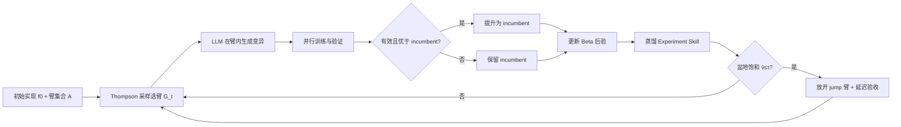

# RecHarness：用 Bandit 路由接管搜索方向的自演化推荐系统框架（arXiv:2607.29241）

> **英文标题**：RecHarness: A Bandit-Routed Agentic Harness for Self-Evolving Recommender Systems
> **作者 / 机构**：Haoran Ling、Yuecheng Li、Zeyu Song（共同一作）et al.，Georgia Institute of Technology + 快手（Kuaishou Technology）
> **发表**：arXiv:2607.29241v1 [cs.IR]，2026-07-31；PDF 共 9 页（正文 + 参考文献），无附录
> **代码**：https://github.com/6lyc/RecHarness
> **一句话**：把「下一轮改哪个方向」从 LLM 手里拿走交给 Thompson 采样的 bandit，LLM 只在被选中的编辑臂内写代码，Amazon 平均 HR@10 相对 HSTU 冷启动模板提升 12.58%，短视频广告线上 7 天 A/B 的 ADVV +2.084%。

## 0. 三十秒速览

| 项 | 内容 |
|---|---|
| 解决什么问题 | 让通用 MLE Agent 直接做推荐模型迭代时，「选方向」和「写代码」耦合成一次 LLM 决策，候选在开放空间发散、无预算分配，单次 trial 训练成本又很高，导致成功率低 |
| 核心手段 | 编辑臂集合 + Thompson 采样路由决定「去哪搜」（二值成功奖励），LLM 依据 incumbent、日志、Experiment Skill 决定「怎么搜」；局部盆地饱和时放开 jump 臂并用延迟判据验收 |
| 关键结果（实验/离线） | Amazon 四数据集平均 HR@10 从 0.4723 提到 0.5317（HSTU，+12.58%），GRU4Rec 上 0.2685 → 0.4990（+85.85%）；KuaiRec D2Q WT-XAUC +12.00%；trial 级命中率 47.92% vs 21.74%（TR w/ LLM）（Table 3、Table 4、Table 5） |
| 关键结果（线上/生产） | 短视频广告 7 天、10% 流量 A/B：ADVV +2.084%、Revenue +0.534%、Exposure +0.559%；离线生产 AUC +0.09%（Table 6、§Online A/B Test） |
| 是否开源 / 是否上生产 | 代码开源；候选已在该广告排序系统完成线上 A/B，但未见全量推全的说明 |
| 我最该记住的一点 | 标量反馈和文本反馈必须走两条互不覆盖的通道：Experiment Skill 被显式禁止参与排序和替换 Thompson 采样，这是混合系统不塌回「纯 LLM 直觉」的关键约束（§Experiment Skill and Feedback） |

## 1. 摘要（忠实译述）

优化现代推荐模型仍高度依赖工程师手工迭代架构、目标与训练策略的改动。LLM 智能体能够自动化这一试错过程，但若让 LLM 同时选择修改方向并生成具体假设，在有限实验预算下常导致搜索不稳定。针对此问题，作者提出 RecHarness——一个面向推荐模型自动化优化的 bandit 路由智能体框架（Bandit-Routed Agentic Harness）。RecHarness 把优化过程拆成两步：bandit 路由器根据历史验证反馈选择下一个修改方向，LLM 在所选方向内生成具体的优化假设与可执行代码修改。为支撑长时程探索，RecHarness 使用 jump-basin 机制，在局部编辑停滞时启用结构性跳变臂。在多个推荐任务、数据集与模型骨干上，RecHarness 相比 LLM 推理式搜索取得更稳定的性能提升，并更有效地使用有限的 trial 预算。在一个大规模短视频广告平台的 7 天线上 A/B 测试中，被选中的候选使 ADVV 提升 2.084%、Revenue 提升 0.534%、Exposure 提升 0.559%。代码见 GitHub 仓库。

## 2. 核心贡献

1. **把「方向选择」与「代码变异」解耦成两级决策**：方向由 Thompson 采样的 bandit 路由给出，具体编辑由 LLM 在臂内生成。这解决的是「每个 trial 都要真实训练一次、预算有限但 LLM 在开放空间里随机发散」这一工程痛点——搜索从「LLM 自由提假设」变成「带后验的臂竞争」（§Methodology）。
2. **同一份验证反馈同时充当两种角色**：标量分数更新 Beta 后验用于分配 trial，文本摘要（Experiment Skill）只作为 LLM 的条件输入、不参与排序。这个双通道隔离是本文最可复用的设计约束，因为它堵住了「文本摘要悄悄覆盖标量证据」的退化路径（§Experiment Skill and Feedback）。
3. **basin-aware jump + 延迟验收（retuning window）**：结构类改动先做 $R$ 轮局部重调，再与跳变前 incumbent 比较，超过 $\delta_{jump}$ 才算接受。它针对的是「结构性改进初始验证分数必然难看」这一老问题（§Basin-aware Jump and Retuning，Eq. 17）。
4. **跨场景与线上的实证**：两个推荐场景、八个模型（五个序列推荐骨干 + 三个 KuaiRec 反馈建模模型）、固定 43,200 s GPU 预算，并给出一次真实线上 A/B（§Experiments、Table 3、Table 4、Table 6）。

## 3. 问题与动机

痛点有两层。第一层是**预算**：推荐模型的每次候选改动都要走代码生成 → 执行 → 训练 → 验证的完整链路，trial 成本不可忽略；而推荐优化不是一组独立的一次性实验，而是连续迭代。第二层是**信息**：每个 trial 除了最终验证分数，还携带收敛行为、训练稳定性、暴露出的失败模式等证据，这些必须结合当前模型状态与历史改动来解读（§Introduction）。

作者点名了三条前人路线及其缺陷：（a）AutoML 系的 HPO 与 NAS 在预定义配置空间内工作，只调标量超参或在固定架构模板内搜索，做不了「重写损失函数、换架构块、改池化策略」这类代码级改动（§Related Work）；（b）AIDE、AIRA 一类把 MLE Agent 建模为程序搜索，本质是 gradient-free，把执行反馈压缩成标量分数只用于排序与剪枝，丢掉了日志与训练动力学的信息（§Related Work）；（c）Reasoning-as-Gradient 这类文本梯度路线反过来强调日志、动力学、验证结果都是文本优化信号，但没有解决「预算该怎么分配」（§Related Work）。

支撑立论的是两条外部证据：in-context bandit 实验显示通用 LLM 需要外部摘要或算法支撑才能可靠探索（Krishnamurthy et al. 2024）；LLM 增强的多臂 bandit 工作显示 LLM 推理与古典 bandit 机制结合优于让 LLM 直接选臂（Sun et al. 2026）。作者据此得出关键观察：**验证反馈应当既是给 LLM 的文本反馈，也是给路由器的显式后验状态**（§Introduction）。

## 4. 方法

### 4.1 总体框架

RecHarness 把推荐模型迭代组织成三级控制过程：Level 1 由人给出优化目标、验证指标、候选编辑臂；Level 2 的 bandit 路由器用标量验证反馈分配 trial 预算，决定下一轮搜哪些编辑维度；Level 3 用 Experiment Skill + LLM 推理在选中方向内产出假设、可执行变异、验证分数与文本教训。一句话概括分工：**人定义优化什么、有哪些臂；harness 决定去哪里分配 trial、如何形成下一个假设**（§Methodology）。

### 4.2 臂空间与 incumbent 条件变异

搜索空间是一组预定义的可解释编辑臂 $A=\{a_1,\dots,a_K\}$（Eq. 4），臂表示「编辑维度」而非具体 patch 或标量超参：学习率调度、dropout/权重衰减、embedding 维度、层数/注意力头数、序列池化策略、特征增补、损失函数等（§Methodology）。按编辑粒度再拆成局部臂与跳变臂 $A=A_{local}\cup A_{jump}$，两者不相交（Eq. 5）。

搜索是 incumbent-based：第 $t$ 轮以当前最优实现 $f_t^\star$ 为基准做变异，而不是反复改原始模板：

$$f_{t,a}=\mu_\phi\left(f_t^\star,\; a,\; m_t,\; \ell_t\right) \tag{6}$$

其中 $a$ 为路由选中的臂，$m_t$ 为 Experiment Skill，$\ell_t$ 为近期日志与验证轨迹摘要，$\phi$ 为冻结的代码生成 LLM。候选只有在验证指标严格超过 incumbent 时才晋升（Eq. 7），否则 incumbent 不变——这一条把「回退」变成默认行为，也是它比自由搜索稳的直接原因。

### 4.3 Thompson 路由、二值奖励与盆地跳变

每个臂维护 Beta 后验 $\theta_a\sim\mathrm{Beta}(\alpha_a,\beta_a)$（Eq. 11），每轮从各可用臂采样并取采样值最大的 $G$ 个组成试验组 $G_t=\mathrm{TopG}_{a\in A_t}\,\tilde\theta_a$（Eq. 13），组内 $G$ 个候选并行执行。奖励不是连续的，而是二值成功信号：

$$r_t(a)=\mathbb{I}\Big[f_{t,a}\ \text{valid}\ \wedge\ \hat b_t(a)>0\ \wedge\ M(f_{t,a})\ge s_t^\star\Big] \tag{10}$$

$$\hat b_t(a)=\frac{\Delta_t(a)-\mathrm{mean}_{b\in G_t}\Delta_t(b)}{\mathrm{std}_{b\in G_t}\Delta_t(b)+\epsilon},\qquad \Delta_t(a)=M(f_{t,a})-s_t^\star \tag{8,9}$$

$\hat b_t$ 用组内均值/标准差把同轮并行候选的改进归一化，解决「不同轮次分数尺度不可比」的问题；$\epsilon$ 只为数值稳定。成功后验按 $\alpha_a\leftarrow\alpha_a+r_t(a)$、$\beta_a\leftarrow\beta_a+1-r_t(a)$ 更新（Eq. 12）。要特别注意：作者明确声明**不假设每个臂有固定的全局成功率**，后验统计只作为有限预算下分配 trial 的「局部证据」（§Recommender Optimization as a Bandit Problem）——这是对 Beta-Bernoulli 平稳性假设的自我放松，也留下了理论缺口（见 §6.2）。

盆地判定用 $W$ 轮窗口的改进率：

$$\hat v_t=\frac{s_t^\star-s_{t-W}^\star}{W},\qquad J_t=\mathbb{I}[\hat v_t\le\tau],\qquad A_t=A_{local}\cup A_{jump}\ \text{if}\ J_t=1 \tag{15,16}$$

$J_t=1$ 只是让跳变臂有资格参与选臂，不强制跳。跳变被接受需要延迟判据：从跳变候选再跑 $r$ 轮局部重调后，最优结果须超出跳变前 incumbent 至少 $\delta_{jump}$，即 $\max_{0\le r\le R}M(f^{(a)}_{t,r})-s_t^\star>\delta_{jump}$（Eq. 17）。这等于把「结构改动先适配、再评判」，代价是验收延迟 $R$ 轮。

### 4.4 训练与运行流程

1. **数据与模板**：序列推荐用四个 Amazon Reviews 数据集（Movies / Scientific / Electronics / CDs，每个用户与物品至少 5 次交互），leave-last-out 划分，倒数第二个物品作验证、最后一个作测试，每例 1 正 99 负采样；KuaiRec 用于 watch-time / watch-ratio / ranking 预测（§Tasks and datasets、§Metrics）。
2. **初始化**：每次 run 从一个冷启动模板 $f_0$ 开始，先跑一个 baseline trial，再在 bandit 臂下搜索候选（§Search protocol）。
3. **每轮执行**：每轮并行评估多个 trial（消融统一为每轮 4 个），每个候选在隔离工作区执行，返回验证分数、日志、错误与状态；只有当轮预算不足以再跑一组 trial 时停止（§Trial execution and budget）。
4. **预算口径**：每个模型固定总 GPU 时间 43,200 s（=12 GPU 小时），所有对比方法共享这一预算（§Trial execution and budget）。
5. **晋升与 Skill 刷新**：只晋升「可执行且优于 incumbent」的候选；随后按 $m_{t+1}=\mathrm{Summarize}(m_t,\{a,f_{t,a},M(f_{t,a}),e_{t,a}\}_{a\in G_t})$ 重渲染 Experiment Skill（Eq. 14），成功 trial 蒸馏为可复用教训，失败 trial 提炼为回避规则（如接口不匹配、训练崩溃、已知低收益编辑）。注意 Skill 只影响 $\mu_\phi$，不影响后验更新。

## 5. 实验与证据

### 5.1 设置

| 维度 | 内容 |
|---|---|
| 数据集 | Amazon Reviews 四个（Movies 11,947 用户 / 17,490 物品 / 144,071 交互；Scientific 23,627/25,764/266,164；Electronics 27,601/31,533/292,308；CDs 18,481/30,951/284,695）（Table 1）；KuaiRec（训练 12,530,806 交互、测试 4,676,570）（Table 2） |
| Baseline | 五个序列骨干 GRU4Rec、BERT4Rec、NextItNet、SASRec、HSTU 的冷启动模板（Base），外加 Kim et al. (2025) 报告值（Paper）；KuaiRec 上 D2Q、TPM、GR 的 Base 与 Ma et al. (2026) 报告值（Table 3、Table 4） |
| 指标 | HR@10/20、NDCG@10/20；Amazon 汇总用四数据集等权的 Avg. HR@10（Eq. 18）；KuaiRec 用 WT-XAUC、WT-MAE、WR-XAUC、WR-MAE（§Metrics） |
| 算力/预算 | 每模型 43,200 s GPU 时间；消融每轮 4 个并行 trial，结果 over three runs（§Trial execution and budget、§Ablation Study、Fig. 2） |
| 消融 | SASRec 固定为骨干，四个 Amazon 数据集；对照 TR w/ Random、TR w/ LLM、w/o Bandit（§Ablation Study） |

### 5.2 主结果

Amazon Reviews（Avg. HR@10，越高越好；括号内为我按 Table 3 计算的相对 Base 增益）：

| 骨干 | Base | RecHarness（Ours） | Paper (Kim et al. 2025) | 相对 Base |
|---|---|---|---|---|
| GRU4Rec | 0.2685 | 0.4990 | 0.4188 | +85.85% |
| BERT4Rec | 0.4066 | 0.4921 | 0.4391 | +21.0% |
| NextItNet | 0.3156 | 0.4934 | 0.3747 | +56.3% |
| SASRec | 0.5035 | 0.5558 | 0.4725 | +10.4% |
| HSTU | 0.4723 | 0.5317 | 无 | +12.58% |

上表最关键的一句解读：**增益大小基本随冷启动模板的强弱反向变化**（GRU4Rec +85.85% 最大，SASRec/HSTU 落在 10–13%），且五个骨干无一例外为正、均超过 Kim et al. (2025) 的匹配结果，说明收益主要来自「把未调模板调到合理配置」而非「超越已调优 SOTA」；论文正文只给了 85.85% 与 12.58% 两个数（§Overall Performance），中间三行的百分比是我自己算的。

KuaiRec（Table 4，括号为相对 Base 变化，↑ 越高越好 / ↓ 越低越好）：

| 模型 | WT-XAUC ↑ | WT-MAE ↓ | WR-XAUC ↑ | WR-MAE ↓ |
|---|---|---|---|---|
| D2Q Base → Ours | 0.5310 → 0.5947 (+12.00%) | 3.4129 → 3.3107 (−2.99%) | 0.7307 → 0.7444 (+1.87%) | 0.3558 → 0.3451 (−3.01%) |
| TPM Base → Ours | 0.5342 → 0.5808 (+8.72%) | 4.5372 → 3.3406 (−26.37%) | 0.7012 → 0.7418 (+5.79%) | 0.4730 → 0.3481 (−26.41%) |
| GR Base → Ours | 0.6161 → 0.6176 (+0.24%) | 3.1901 → 3.1851 (−0.16%) | 0.7528 → 0.7535 (+0.09%) | 0.3323 → 0.3319 (−0.12%) |

同样是一句解读：TPM 上两个 MAE 各降约 26%（4.5372 → 3.3406、0.4730 → 0.3481）是真收益，但强基线 GR 的四项分别只有 +0.24% / −0.16% / +0.09% / −0.12%，量级落在噪声区且论文未给方差或显著性检验（Table 4，⚠️ 见 §5.4）。

### 5.3 消融与关键发现

- **路由确实在起作用，不只是记录历史**：Table 5 中 RecHarness 有 23/48 = 47.92% 的非 baseline trial 刷新了轮初最优验证分数，TR w/ Random 为 11/49 = 22.45%，TR w/ LLM 为 10/46 = 21.74%。这个对比证明「用累积标量反馈分配 trial」优于「随机选臂」和「让 LLM 读文本历史选臂」——后者只比随机好一点点，是本论文对「LLM 不擅长探索」最直接的支持证据（Table 5、§Analysis Experiments）。
- **结构化臂维度买到的是上限，不是命中率**：w/o Bandit（去掉预定义编辑维度、让 LLM 自由提改动）命中率仍有 20/48 = 41.67%，接近 RecHarness 的 47.92%，但最大增益只有 10.16%，远低于 RecHarness 的 24.00%（平均增益 4.05% vs 5.06%）。作者据此论证自由 LLM 搜索能找到有用方向，但不擅长把 trial 押到高上限方向（Table 5）。⚠️ 注意这个结论完全建立在「最大增益」这类极值统计上。
- **验证曲线早期就分叉**：Fig. 2 中从 0.5050 起步，RecHarness 第 2 轮达 0.6125、第 4 轮达 0.6342，全程高于三个消融变体，说明路由在早期就把预算集中到高回报方向（Fig. 2、§Ablation Study）。
- **线上案例值得单独看**：局部臂反复无稳定增益后，路由器判定接近盆地天花板，放开 jump 臂并选中 `sequence_encoder_upgrade`；LLM 依据 Experiment Skill 里「现有 HSTU 相关模块只处理压缩虚拟 token、没有建模原始行为序列内的 item-item 交互」这一诊断，生成对六条实时行为序列各自做 self-attention、各经 MLP 压成 32 维、拼成 192 维注入 shared-bottom 排序器的候选；离线生产 AUC +0.09%，线上 ADVV +2.084%、Revenue +0.534%、Exposure +0.559%（§Online A/B Test、Table 6）。

### 5.4 证据边界

- **有支撑**：（i）同等 GPU 时间预算下，bandit 路由的 trial 命中率显著高于随机选臂与 LLM 读文本选臂（Table 5，三个对照在同一 SASRec 模板、同预算、同并行度下）；（ii）增益跨两个场景、八个模型一致为正（Table 3、Table 4）；（iii）至少存在一个可上线、且线上业务指标为正的具体候选（Table 6）。
- **弱支撑**：跨骨干的「一致性」很依赖冷启动模板的弱度——Base 越弱增益越大（GRU4Rec +85.85% vs SASRec +10.4%），因此这组实验证明的是「调参式搜索有效」，而不是「RecHarness 能超过已充分调优的 SOTA」；强基线 GR 上四项改动均在 ±0.24% 内且无方差报告，属于「方向对、证据薄」（Table 4）。
- **无支撑**：（i）论文声称 Experiment Skill 与 bandit 各自有独立贡献，但消融只做了「TR w/ Random」「TR w/ LLM」「w/o Bandit」，**没有单独去掉 Experiment Skill** 的变体，因此「文本通道有用但不越权」只由 TR w/ LLM 变差间接支持；（ii）Beta-Bernoulli 后验在非平稳奖励下的收敛性/后悔界，全文无分析；（iii）臂集合 $A$、阈值 $\tau$、窗口 $W$、重调轮数 $R$、边际 $\delta_{jump}$、组大小 $G$ 的取值全部只写在未随 v1 提供的 Supplement 中（§Trial execution and budget 原文写「More details in Supplement」），正文无法复现；（iv）线上结论只来自一个候选、一个场景、7 天、10% 流量，且 ADVV +2.084% 没有置信区间，离线 AUC +0.09% 到 ADVV +2.084% 的传导链条未解释。

## 6. 深度分析

### 6.1 为什么可能有效（机制层）

**第一，它把探索成本从「语言能力」转移到了「统计机制」。** 推荐模型迭代的奖励结构极度嘈杂：同一次结构改动，不同随机种子下验证 HR@10 的波动往往和真实增益同量级。LLM 读一段文本历史去判断「哪个方向值得试」，实际是在做一次低带宽、无校准的贝叶斯推断；而 Beta 后验 + Thompson 采样天然带「不确定性奖励」（采样方差大的臂更容易被选中），对噪声奖励的鲁棒性来自设计而非模型能力。Table 5 里 TR w/ LLM（21.74%）只比随机（22.45%）略低，正是「让 LLM 直接选臂不可靠」的经验证据，作者引用的 Krishnamurthy et al. (2024)、Sun et al. (2026) 也指向同一结论。

**第二，二值化奖励 + 组内归一化把异质 trial 变成可比事件。** 连续增益 $\Delta_t(a)$ 在不同轮、不同数据集上尺度差异巨大（Amazon HR@10 的绝对改进常在 0.00x 量级，KuaiRec MAE 则是 3.x 量级），直接用连续奖励会让后验被尺度主导。Eq. 9 先按组内均值/标准差归一化再取符号，等价于把「本轮相对同组候选是否更好」当作奖励，既消掉尺度，也顺手实现了组内相对竞赛式的信用分配。我的判断：这个设计贡献的稳定性可能不低于 Thompson 采样本身，但论文没做拆解实验。

**第三，incumbent 单调 + 延迟验收构成两层安全网。** Eq. 7 保证分数不退化，Eq. 17 保证结构类改动不会因为「刚改完还没重调」被误杀。二者合起来把搜索地形从「LLM 自由跳」变成「在单调提升的子空间里带迟滞地跳」，这与 bandit 的乐观探索互补：前者管不倒退，后者管不困在局部。

**第四，Experiment Skill 的作用是压缩上下文而非参与决策。** 它的价值在于把「哪类接口会崩、哪类编辑低收益、近期趋势如何」这类高熵日志压成几百 token 的稳定条件输入，让 LLM 在受限方向内少犯重复错误。它被禁止参与排序，恰恰避免了「文本叙事自我强化」——这是大多数 LLM 自迭代框架最典型的失败模式（反复提议同一类无效改动）。线上那个候选就是这条链路的具体产物：Skill 里沉淀的「HSTU 模块只处理压缩虚拟 token」诊断，直接决定了 self-attention 候选的形状。

### 6.2 可疑之处

1. **Base 是冷启动模板，不是调好的基线（作者口径清楚，但结论容易被过度解读）**。Table 3 中 GRU4Rec 在 Movies 上 H@10 从 0.2317 到 0.5179，相对提升 123%（我的计算）；而 Kim et al. (2025) 报告的 0.4883 也在同一量级。这说明冷启动模板离「合理配置」很远，+85.85% 买的是「把没调的模型调好」，不是「超越 SOTA」。论文标题与摘要里的「consistently improves」在读者脑中很容易被读成后者。
2. **KuaiRec 强基线增益在噪声内且无显著性（我的推断）**。GR 上四项 +0.24% / −0.16% / +0.09% / −0.12%（Table 4），方向互相矛盾（MAE 降但 XAUC 只 +0.24%），论文全文未报告标准差、置信区间或种子数；Table 3 说「averaged over three runs」，Table 4 未说明。以短视频 watch-time 任务的经验方差，这类量级无法区分于随机波动 ⚠️。
3. **消融的分母不同，且极值统计主导结论（我的推断）**。Table 5 四个方法的 Improving/All 分别是 23/48、11/49、10/46、20/48——总 trial 数不同说明各变体的吞吐/停止时机不同，而预算按 wall-clock GPU 时间固定，于是「同预算」实际上比较的是「不同样本数」，命中率的分母不可直接对齐。「w/o Bandit 上限低」这一核心论证又只靠 max gain（24.00% vs 10.16%）这种单点极值，对种子极敏感 ⚠️。
4. **D2Q 的 Paper 列数值反常（作者未解释）**。Table 4 中 D2Q 的 WT-MAE：Base 3.4129、Ours 3.3107，而 Paper (Ma et al. 2026) 是 5.4260——被引工作在自己论文里的指标明显差于本文的冷启动模板，提示两者的 MAE 口径（是否归一化、是否加权、评估切分）很可能不同。作者把它当作「超越」证据但未讨论口径 ⚠️。
5. **「首个」声明与成本账**。贡献列表写「the first optimization harness for self-evolving recommender systems」，但 Related Work 同段就列了 Google 双环框架 (Wang et al. 2026)、GEARS、AgentX、EvoRec、NOVA 五个同类系统（§Related Work）。我的判断：这个「first」只能理解为「第一个把方向选择交给 bandit 的 harness」，按字面读站不住。另外全文没有算经济账：43,200 s GPU/模型 × 8 个模型的搜索成本，与节省的工程师工时相比是否划算，论文没给。
6. **非平稳性与 Beta 假设的张力（作者已承认一半）**。作者声明不假设固定全局成功率、后验只作局部证据（§Recommender Optimization as a Bandit Problem），但更新规则 Eq. 12 是标准 Beta-Bernoulli，没有任何折扣、滑窗或重置机制。长期运行下早期证据会永久占据后验质量，论文未量化这一风险，也未做「陈旧后验」实验 ⚠️。

## 7. 与同族工作对比

| 工作 | 核心差异 | 相对优势 | 相对短板 |
|---|---|---|---|
| 本文 RecHarness（2607.29241） | 方向由 Thompson 采样的编辑臂路由决定，LLM 只在选中臂内生成代码；文本 Skill 不参与排序 | 方向选择不依赖语言能力，命中率与上限都可量化；有真实线上 A/B | 臂空间需人工预设；无理论保证；强基线上增益接近噪声 |
| EvoRec（2606.28368，阿里国际） | 从持久化实验记忆里蒸馏可复用方法论，模型与方法协同演化 | 方法论可跨次累积复用 | 方向仍由 LLM/记忆决定，预算分配无显式机制 |
| AgentX（2606.26859，快手） | 生产级四阶段闭环，把执行轨迹蒸馏为语义梯度更新 agent 自身 | 生产闭环完整，agent 会自我改进 | 同样是 LLM 自决方向，无 bandit 级预算分配 |
| NOVA（2606.27243，腾讯） | 用 SGD 启发的「架构梯度」聚合历史编辑、诊断与指标反馈来引导架构演化 | 架构层面演化更系统 | 仍属梯度式启发，非显式后验；依赖人工设计聚合式 |
| Google 双环框架（2602.10226，Google/YouTube） | 内环用廉价代理指标筛假设，外环用延迟业务指标验证候选 | 业务指标对齐更严 | 两环都是筛选而非预算分配，方向选择仍靠 LLM |

一句话读法：同族四条路线都在「让 LLM（或它的蒸馏物、梯度聚合）更聪明地决定方向」，只有本文把方向决策移交给**不依赖语言能力的统计机制**，LLM 退化为「方向内的假设生成器」。这也解释了 w/o Bandit 能找到有用编辑却上限更低：稳定搜索来自结构化编辑维度 + 后验分配，而不是来自 LLM 的提议质量（Table 5）。

## 8. 可迁移 / 复现要点

1. **先造「臂表」，再写 agent**：第一步不是接 LLM，而是把目标模型的编辑空间列成 8–15 个语义互斥的编辑维度（学习率调度、正则、embedding 维度、层数/头数、池化、特征增补、损失函数、结构升级），并标注局部臂与跳变臂。验证方式：人工按臂表逐一手改，确认每条臂至少有一次能产生非零验证增益。
2. **奖励先二值化再谈路由**：按 Eq. 9 用同轮并行组的均值/标准差归一化，奖励取 $\mathbb{I}[\text{valid}\wedge\hat b_t>0\wedge M\ge s^\star_t]$。二值奖励在 $K$ 小（<10）时后验收敛慢，建议 $G\ge4$ 并行以保证每轮样本量；无法并行时用滑动窗口统计替代组内归一化。
3. **把「不退化」写进代码而不是 prompt**：晋升条件是严格大于 incumbent 且可执行（Eq. 7）。实现要点是每个候选在隔离工作区跑，失败/崩溃/超时一律记为 reward=0 而不是丢弃——本文正是靠「失败也更新后验」让路由器学会回避崩溃方向。
4. **文本通道必须单向**：Experiment Skill 只作为 LLM 的条件输入，禁止进入排序、禁止回答「该选哪条臂」。可以用接口层面的硬隔离实现（Skill 文档不进 router 的输入），否则 LLM 会通过写 Skill 间接操纵路由。
5. **跳变要配重调窗口**：先把 $\tau$（改进率阈值）、$W$（窗口）、$R$（重调轮数）、$\delta_{jump}$（接受边际）设为可配置，跑一次「只开局部臂」的长跑记录饱和曲线，用饱和点的改进率反推 $\tau$。复现成功的判据我建议用两条：平均 HR@10 的增益随 Base 弱度单调上升（与 Table 3 的模式一致），且 trial 命中率显著高于随机选臂（对照 Table 5 的 22.45%）。

## 9. 局限与未解决问题

- **作者自述**：v1 正文**没有 Limitations 章节**（Conclusion 后直接是 References），只散落两处自我限定：臂集合由人定义、目标场景为推荐（§Methodology 的「human-defined candidate arms」）；不假设固定全局成功率、后验仅作局部证据（§Recommender Optimization as a Bandit Problem）⚠️。
- **我读出的**：一是臂表人工预设意味着上限由人定，跨场景迁移要重设计整张臂表，所谓「self-evolving」实际是「在人工臂空间内自演化」；二是整套系统依赖一次 trial 的真实训练成本，预算小于「至少两组并行 trial」时机制直接失效（论文的停止条件正是「剩余预算不足以再跑一组」）；三是超参（$\tau,W,R,\delta_{jump},G$）与臂表细节都在未随 v1 提供的 Supplement 里，复现门槛被显著抬高；四是所有实验的 Base 都是冷启动模板，缺少「与已调优强基线的同等预算对比」这一最关键对照。
- **值得做的后续**：（i）把 Beta 换成带折扣的后验（如指数遗忘或滑窗计数），在长跑（≥30 轮）下对比陈旧证据的影响，这正好能检验作者对非平稳性的口头放松；（ii）补一个「单独去掉 Experiment Skill」的消融，分离文本通道对 LLM 生成质量与路由行为的贡献；（iii）把臂表从人工预设改为「LLM 提议新臂 + 后验筛选新臂」的两层结构，让臂空间本身可演化，这是本文「self-evolving」叙事真正缺失的一环。

## 10. 术语表

| 术语 | 含义 |
|---|---|
| Harness | 把「生成候选—训练—验证—晋升」串成闭环的调度外壳，本文指 RecHarness 这个控制框架本身 |
| 编辑臂（edit arm） | 一个可解释的编辑维度（如「改池化策略」），不是具体 patch；bandit 的被选对象 |
| incumbent | 当前验证集上最优、被后续所有变异当作基准的那份实现 $f_t^\star$ |
| Thompson 采样 | 从每个臂的 Beta 后验采样一次成功率，取采样值最大者，自带探索-利用平衡 |
| Experiment Skill | 由实验记忆自动蒸馏出的文本指南（当前 incumbent、成功编辑、回避规则、趋势摘要），仅作 LLM 条件输入 |
| basin / jump arm | 局部盆地指 incumbent 附近可继续微调的区域；jump arm 指可能跳出该区域的结构性改动 |
| ADVV | Advertiser Value，广告主价值，本文线上主指标（引 Chai et al. 2025） |
| XAUC / MAE | KuaiRec 上 watch-time / watch-ratio 的排序与回归指标，XAUC 越高越好、MAE 越低越好 |

## 11. 原文定位

| 内容 | 位置 |
|---|---|
| 主结果（Amazon 五骨干） | Table 3、§Overall Performance |
| 主结果（KuaiRec 三模型） | Table 4、§Overall Performance |
| 消融曲线与 trial 级统计 | Fig. 2、Table 5、§Ablation Study、§Analysis Experiments |
| 线上 A/B | Table 6、§Online A/B Test |
| 关键公式（变异 / 晋升 / 奖励 / 后验 / 跳变） | Eq. 6、Eq. 7、Eq. 8–10、Eq. 12–13、Eq. 15–17（§Methodology） |
| Skill 更新式 | Eq. 14（§Experiment Skill and Feedback） |
| 预算与并行口径 | §Trial execution and budget、§Ablation Study |
| 数据集统计 | Table 1、Table 2、§Tasks and datasets |
| 局限讨论 | 无 Limitations 章节；相关限定见 §Methodology、§Recommender Optimization as a Bandit Problem ⚠️ |
