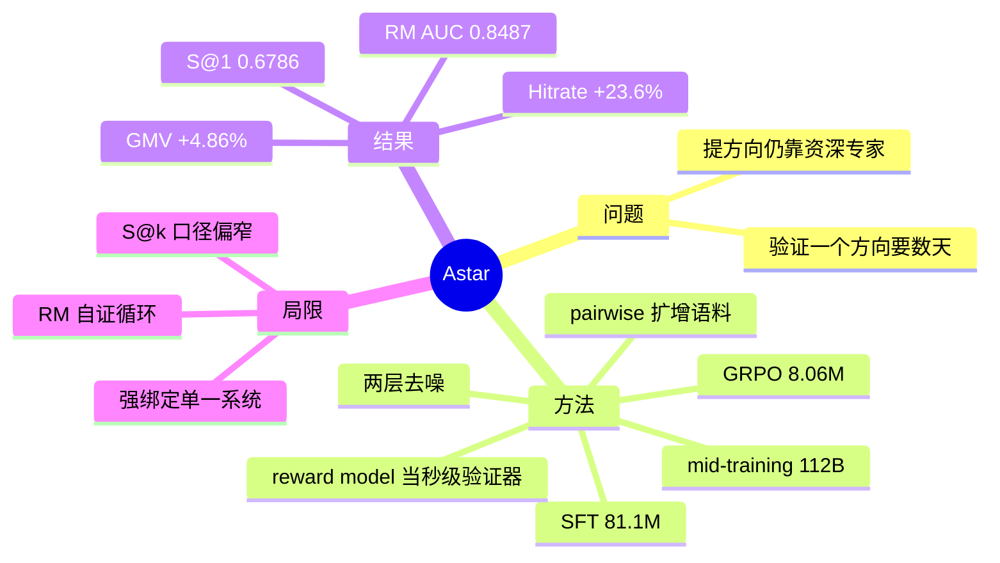
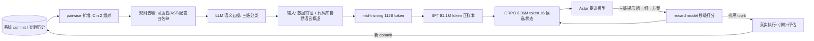

# Astar：学习提出进化方向的自进化工业 AI 系统（arXiv:2608.27287）

> **英文标题**：Astar: Learning to Propose Evolution Directions for Self-Evolving Industrial AI Systems
> **作者 / 机构**：Jinxin Hu、Hao Deng、Haibo Xing、Lingyu Mu、Muyu Zou 等 17 人 / 阿里巴巴 + 浙江大学
> **发表**：arXiv:2608.27287v1，2026-08-27；cs.IR
> **代码**：未开源
> **一句话**：把「提出进化方向」这一步从人工经验改为训练一个专用模型——用工业系统自身 commit 历史造语料，按 mid-training → SFT → RL 三阶段训出 Astar，单次提议成功率 0.6786（人类专家 0.3229、GPT-5.5 0.3071），并在 Lazada 广告召回上闭环跑通 20 次连续迭代，线上 GMV +4.86%。

## 思维导图

## 0. 三十秒速览

| 项 | 内容 |
|---|---|
| 解决什么问题 | 「提方向 → 写代码 → 训练 → 评估」四步闭环里，后三步已被 LLM/agent 自动化，唯独起点仍依赖资深科学家：门槛高（要同时读懂业务、数据、配置、训练曲线）、验证贵（一个方向要数天） |
| 核心手段 | 用系统自身的 commit/实验历史当语料：pairwise 扩增 + 两层去噪（规则 + LLM 语义）→ 自然语言代码概述作输入 → mid-training（112B token）→ SFT（81.1M token 正样本）→ GRPO（8.06M token，16 候选/状态）；reward model 充当秒级验证器 |
| 关键结果（离线） | S@1 0.6786（人类 0.3229、GPT-5.5 0.3071）；S@3 0.7857；RM@1 0.7183；RM 预测 AUC 0.8487（人类 0.6142、最强通用 LLM 0.5997） |
| 关键结果（线上） | Lazada 广告在线召回：两周 20 次连续迭代，离线 Hitrate@200 累计 +23.6%；A/B（2026-07-01~05）GMV +4.86%、广告收入 +1.82%、Click +0.84%、Order +1.79%（p<0.05） |
| 是否开源 / 是否上生产 | 未开源；Lazada 生产系统上闭环并做线上 A/B |
| 我最该记住的一点 | 「专家经验不可 prompt 注入，只能参数内化」——mid-training 单项就把 RM@1 从 0.0380 抬到 0.6041，这是全篇最硬的证据 |

## 1. 摘要（忠实译述）

现代 AI 系统通过持续迭代进步：一个「提出进化方向 → 实现代码 → 训练 → 评估」的循环。后三步已借助 LLM 与 agent 大幅自动化，但起点——提出进化方向——仍依赖资深人类专家的经验，成为整个闭环的瓶颈。我们提出 Astar，一个从系统自身迭代历史中学习、以参数形式内化这类经验的自进化系统。具体而言，Astar 采用三阶段训练：mid-training 学习输出格式与领域结构，监督微调（SFT）学习哪些方向值得提出，强化学习（GRPO）进一步优化提议质量；同时训练一个 reward model 作为快速代理，把「是否值得执行」的判定从数天压缩到数秒。在真实执行评估中，Astar-8B 的单次提议成功率 0.6786，远超人类专家（0.3229）与最强通用 LLM（0.3071）。更重要的是，Astar 闭合了循环：在 Lazada 广告在线召回模型上两周内驱动 20 次连续迭代，离线 Hitrate@200 提升 23.6%，线上 A/B 相对提升为 GMV 4.86%、广告收入 1.82%、点击 0.84%、订单 1.79%。

## 2. 核心贡献

1. **把「方向提议」定义成一个可学习任务**，并给出数据构造法：pairwise 扩增把样本量从 $n-1$ 提到 $C(n,2)$；两层去噪把噪声 commit 过滤掉；输入用「数据特征 + 代码库自然语言概述」而非原始代码（§3）。为什么重要：这是把「老专家的直觉」转成训练信号的唯一可行路径——作者先证明了通用 LLM 直接提议不可用（七个前沿模型都「听起来合理但与系统实际需要错配」）。
2. **三阶段训练 + 层级化输出**：mid-training 对齐格式、SFT 学「哪些方向值得提」、GRPO 用 reward model 继续优化；输出结构是「粗粒度方向 → 细粒度修改动作 → 具体修改方案」三级提示（§3.4）。为什么重要：三级结构既是监督信号也是推理时的搜索约束，消融显示去掉它 reward AUC 从 0.8487 掉到 0.7910。
3. **reward model 当作闭环的「秒级验证器」**：AUC 0.8487（8B）/0.8094（0.6B），人类专家 0.6142。为什么重要：真实验证一次要数天，把它换成秒级打分，才可能对「每状态 16 个候选」做 RL；同时同一模型还能在推理期对候选排序，一举两用。

## 3. 问题与动机

工业 AI 的迭代闭环四步（§1）：提方向 → 写代码 → 训练 → 评估。后三步已被 LLM/agent 快速自动化（论文引用了 AgentX、Auto-RecSys 等），但起点仍靠资深科学家。原因有二：**智力门槛**——要同时读懂业务、数据、模型配置与训练曲线；**代价高**——验证一个方向要跑完「实现—训练—评估」，常需数天，方向选错的浪费极大（§1）。

作者的关键判断是：这类专家知识属于**经验积累**而非可显式编码的规则，所以靠 prompt / skill 注入难以奏效，只能让模型从迭代历史里学（§1）。这个判断被后文实验直接反证支撑：未训练的 Qwen3-8B 的 RM@1 只有 0.0380，与通用 LLM 同级；而 mid-training 一项就把它抬到 0.6041。

论文同时点出四个数据/训练层面的难点（C1–C4）：历史记录**稀疏**（相邻 commit 只有 $n-1$ 条）、**噪声大**（大量 commit 与模型效果无关）、**搜索空间大**、**验证贵**。方法章节就是逐条对应这四个难点。

## 4. 方法

### 4.1 总体框架

### 4.2 数据管线

- **pairwise 扩增**：不只用相邻 commit（只有 $n-1$ 条样本），而是任取两个实验版本配对，样本量升到 $C(n,2)$；用完整 loss 曲线客观判定哪个版本更好，并总结两版差异。这样同时学到「短期微调」与「长期跃迁」两类改动（§3.1）。
- **两层去噪**：规则层做可达性分析（调用图剪掉死代码）、AST 归一化（去 print/assert/注释、import 重排）、配置白名单（丢 `output_dir`、`gpu_count`，留 `learning_rate`、`optimizer`）；LLM 层做语义分析，把 diff 映射到三级分类（粗方向/细动作/具体方案），映射不上的判为噪声丢弃（§3.2）。
- **上下文构造**：输入不用原始代码仓库，而用「数据特征 + 代码库的自然语言概述（Basic Information）」。动机是上下文长度与信噪比；消融显示换成原始代码 S@1 从 0.6786 掉到 0.4151（Table 4a）。

### 4.3 训练三阶段

1. **mid-training**：112B tokens 全量历史做 next-token 预测，主要对齐「带层级提示的输出格式」，让模型学会领域术语与结构（§3.3）。
2. **SFT**：用组合指标 $s=(1-\alpha)\ell_T+\alpha\bar{\ell}_k+\gamma\hat{\sigma}_k$ 判定优劣（$\ell_T$ 终值 loss、$\bar\ell_k$ 前 $k$ 步平均、$\hat\sigma_k$ 波动），只留改善样本，共 81.1M tokens（§3.3）。
3. **RL（GRPO）**：8.06M tokens，每状态采样 16 个候选，用 reward model 打分做奖励；并做 reward model 的**增量校准**，防止策略漂移后奖励失真（§3.4）。

### 4.4 层级化提示与推理

输出是三级结构：粗粒度方向 → 细粒度修改动作 → 具体修改方案。推理时按层级逐步收窄搜索空间，相当于把「自由生成代码」变成「在受限空间里选点」。消融：去掉层级提示，reward AUC 0.8487 → 0.7910（Table 4b）。

### 4.5 reward model 作为代理验证器

reward model 以「这个方向是否会让 loss 曲线下降」为标签训练，AUC 0.8487（8B）、0.8094（0.6B）；人类专家在同一任务上的 AUC 是 0.6142，最强通用 LLM 0.5997（§4.1、Table 1）。它同时承担两个角色：RL 的奖励函数，以及推理期对候选方向的排序器。

## 5. 实验与证据

### 5.1 设置

| 维度 | 内容 |
|---|---|
| 数据来源 | 工业推荐系统自身的 commit / 实验历史；mid-training 112B tokens、SFT 81.1M、RL 8.06M |
| 评测任务 | 真实执行评估：给出提议后实际实现、训练、看 loss 是否下降；S@k = 前 k 个提议中至少一个成功的比例 |
| 基线 | 人类专家、GPT-5.5、Claude-4.8-Opus、Kimi-K2.6、DeepSeek V4 Pro 等 7 个通用 LLM；以及不同规模 Astar |
| 部署场景 | Lazada 广告在线召回模型；线上 A/B 2026-07-01 至 07-05 |

### 5.2 主结果

| 指标 | Astar-8B | 人类专家 | 最强通用 LLM（GPT-5.5） |
|---|---|---|---|
| S@1（真实执行成功率） | **0.6786** | 0.3229 | 0.3071 |
| S@3 | **0.7857** | 0.4873 | 0.4615 |
| RM@1（reward model 视角的成功率） | **0.7183** | 0.2041 | 0.1899 |

解读（Table 1）：单次提议成功率是人类专家的 2.1 倍、GPT-5.5 的 2.2 倍；S@3 也从 0.49 拉到 0.79，说明不仅「第一条更好」，候选池整体质量都更高。

规模与消融：

| 维度 | 结果 |
|---|---|
| 规模 | 0.6B 的 S@1 达 0.5435（已超所有基线），4B 0.6338，8B 0.6786 |
| 阶段消融（RM@1） | base 0.0380 → +mid-training 0.6041 → +SFT 0.6853 → +RL 0.7183 |
| 输入格式 | 原始代码 S@1 0.4151 vs 自然语言概述 0.6786 |
| 层级提示 | 去掉后 reward AUC 0.8487 → 0.7910 |

部署结果：Lazada 广告在线召回模型两周内引导 **20 次连续迭代**，离线 **Hitrate@200 累计 +23.6%**；线上 A/B（5 天）**GMV +4.86%、广告收入 +1.82%、Click +0.84%、Order +1.79%**（p<0.05）。效率方面：验证过的方向吞吐从每周个位数提升到**每周百级**，单个方向的人工成本从「小时」级降到「分钟」级（§5）。

### 5.3 证据边界

- **有支撑**：S@k 提升是真实执行结果（不是 RM 代理分）；mid-training 的贡献有明确消融；线上 A/B 拿到了 GMV/收入/点击/订单四个指标。
- **弱支撑**：S@k 的「成功」定义是 loss 曲线是否下降，而 loss 下降与业务指标（Hitrate/GMV）之间隔着召回模型这一层；线上 A/B 只有 5 天、单系统。
- **无支撑**：跨系统迁移没有实验（论文把它列为未来工作）；RM 与策略的自证循环只有「增量校准」这一层缓解，没有系统性偏差的定量分析；每次提议所用上下文的样本规模与候选上限在正文里没有完整给出。

## 6. 深度分析

### 6.1 为什么可能有效（机制层）

三个机制各自解决一个环节的问题，且都能单独测量：**数据侧**（pairwise 扩增 + 去噪）解决「样本稀疏且噪声大」，让监督信号可用；**表示侧**（自然语言代码概述 + 三级结构）解决「搜索空间大」，把生成问题变成受约束选点；**验证侧**（reward model）解决「验证贵」，让 RL 与推理期排序都有了廉价信号。stage 消融的 0.0380 → 0.6041 → 0.6853 → 0.7183 正好对应「领域对齐 → 判断力 → 策略优化」三跳，机制解释与数据一致。

### 6.2 可疑之处

1. **S@k 与业务指标脱节**：成功判据是「loss 是否下降」，而线上看的是 GMV。二者中间隔着一整层召回模型；论文没有给出「S@1 高多少 → 线上涨多少」的映射，因此 0.6786 这个数字容易被过度解读。
2. **reward model 自证循环**：RL 奖励来自 RM，RM 又用同一批标签训练，长期可能把策略推向「RM 喜欢但实际无效」的方向；论文用「增量校准」缓解，但没有报告校准前后 RM 与真实执行的一致性曲线。
3. **人类基线的公平性**：人类专家的 0.3229 出自什么条件下（几位专家、多少时间、能否用代码库）正文没有充分交代；如果专家只有几分钟的上下文，这个对比会放大 Astar 的优势。
4. **绑定单一系统**：语料来自特定 repo 的 commit 历史，模型学到的东西可能包含大量「这个系统的惯例」而非「通用的研究方向感」。跨场景迁移作者自己列为未来工作，这恰恰是「专用小模型」路线最大的疑问。
5. **线上窗口短**：5 天 A/B、单系统、单一召回模型；对 +4.86% GMV 这类结果，缺少置信区间与长期指标（多样性、留存）的观察。

## 7. 与同族工作对比

| 工作 | 核心差异 | 相对优势 | 相对短板 |
|---|---|---|---|
| 本文 2608.27287 | 把「方向提议」训成专用模型（参数内化） | 提议质量可量化、验证成本降三个数量级 | 强绑定单系统，迁移未验证 |
| EvoRec 2606.28368（同批作者） | 同一套「自进化」思想的框架级实现 | 覆盖模型+方法论双轨 | 方向提议仍靠通用 LLM，未参数化 |
| RecHarness 2607.29241（GT+快手） | 用 bandit 在方向空间路由 | 探索-利用有理论框架，通用性强 | 每个方向仍要真实跑，验证贵 |
| AgentX 2606.26859 / AgentX-Model 2609.30001（快手） | agent 搜索 + 生产闭环 / 双 agent 研究闭环 | 端到端、含部署与谱系管理 | 方向选择仰赖通用模型推理，未专门训练 |

> 对比基于机制定位；其余各篇的具体数字本笔记未逐一复核原文。

## 8. 可迁移 / 复现要点

1. **先证明「通用模型不行」**：用你自己的系统历史记录，让 GPT/Claude 提 20 个方向、真实跑 5 个，记录成功率。如果达不到 ~0.3，参数化才有意义；这一步能省掉大量无效投入。
2. **数据比模型重要**：pairwise 扩增（任何两个版本配对 + 用完整 loss 曲线判优劣）通常能把可用样本从「几十条」变成「几千条」，这是最容易先做的一步；去噪白名单按你自己的配置项写。
3. **从秒级验证器开始建闭环**：先训一个「方向是否会降 loss」的 reward model（哪怕 AUC 只有 0.7），用它做候选排序；等它稳定了再上 RL。
4. **输出结构固定成三级**：粗方向 → 细动作 → 具体方案。即使不做训练，这个结构也能用在 prompt 里约束通用模型，收益立刻可测。

## 9. 局限与未解决问题

- **作者自述**：强绑定单一系统，跨场景（内容推荐、基座微调、Agent harness）迁移属未来工作；reward model 的自证循环只用增量校准缓解；评测口径偏窄（S@k 以 loss 为真值）（§6 Limitations）。
- **我读出的**：人类基线的条件交代不足；线上窗口短；「方向提议」与「实现质量」被混在一个成功率里——一个方向好但实现差，仍会被记成失败，这会让模型学到偏保守的方向。
- **值得做的后续**：① 在同一系统上做「Astar 提议 + 固定实现器」与「通用 LLM 提议 + 同一实现器」的对照，剥离实现变量；② 报告 RM 分数与真实执行结果的一致性随时间的漂移；③ 做一次跨 repo 迁移（哪怕只迁移 mid-training 阶段），量化「系统惯例」占比。

## 10. 术语表

| 术语 | 含义 |
|---|---|
| S@k | 前 k 个提议中至少一个在真实执行中成功的比例 |
| RM@k | 用 reward model 判定前 k 个提议中至少一个成功的比例 |
| pairwise 扩增 | 任取两个实验版本配对构造偏好样本，样本量 $O(n^2)$ |
| mid-training | 在领域语料上做 next-token 预测，对齐格式与术语 |
| GRPO | Group Relative Policy Optimization，本文的 RL 算法 |
| 层级提示 | 粗粒度方向 → 细粒度动作 → 具体方案的三级输出结构 |
| Basic Information | 代码库的自然语言概述，替代原始代码作为输入 |
| 增量校准 | 随策略更新同步校准 reward model，防止奖励失真 |

## 11. 原文定位

| 内容 | 位置 |
|---|---|
| 闭环四步与瓶颈 | §1 |
| 四个难点 C1–C4 | §2 |
| pairwise 扩增与两层去噪 | §3.1–§3.2 |
| 三阶段训练 | §3.3–§3.4 |
| 层级提示 | §3.4、Table 4b |
| reward model 与 AUC | §4.1、Table 1 |
| 主结果 S@k / RM@1 | Table 1、§5.1 |
| 规模与消融 | Table 2、Table 3、Table 4 |
| 部署与线上 A/B | §5.2 |
| 局限 | §6 |
