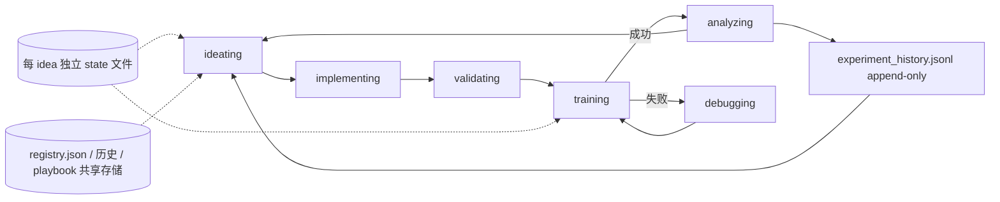
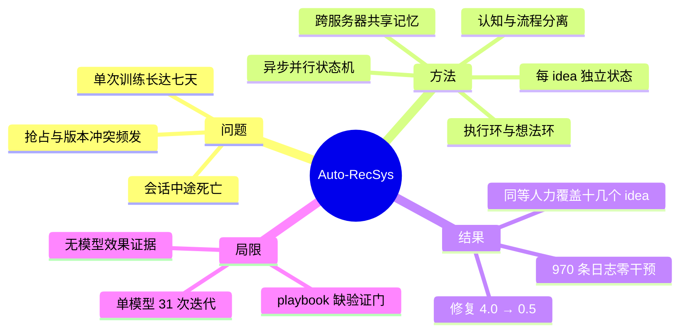

# Auto-RecSys：面向工业级推荐系统的自主研究 Harness（arXiv:2609.10922）

> **英文标题**：Auto-RecSys: Harnessing Autonomous Research Agents for Industry-Scale Recommender Systems
> **作者 / 机构**：Ming Li、Dai Li、Xuying Ning 等 15 人 / Meta + UIUC
> **发表**：arXiv:2609.10922v1，2026-09-10；正文约 9 节 + 附录
> **代码**：未开源
> **一句话**：把「自动研究 agent」从分钟级小实验推到多日训练的工业推荐场景——靠异步并行执行、跨服务器持久记忆、认知-流程分离三件套 + 双环自进化，把每个 idea 的人工投入压到分钟级，并让操作故障随 playbook 成熟系统性消失（4.0 → 0.5 次修复/迭代）。

## 0. 三十秒速览

| 项 | 内容 |
|---|---|
| 解决什么问题 | 工业推荐一次训练就要数天（最长约七天），串行迭代等于自我限流；同时数千行配置、抢占、checkpoint 损坏、包版本冲突让每次运行都可能失败，agent 会话还会中途死掉 |
| 核心手段 | ①分布式异步执行（有限状态机 + 每 idea 独立状态文件）②集中式跨服务器记忆（registry / state / 历史 / playbook 全在共享存储）③认知-流程分离（自然语言 skill 管「为什么」，确定性脚本管「怎么做」）；双环：Execution Evolution（蒸馏死路与配方）+ Idea Evolution（按历史结果改选题） |
| 关键结果 | 同等人力可覆盖「十几个 idea」而非 1 个；31 次迭代中操作修复从 4.0 → 1.3（稳定期）→ 0.5（新基线后），最后 6 次里 5 次零修复（Figure 4、§7.2） |
| 关键结果（线上） | 无线上 A/B；本文不测端到端 cycle time（被训练主导），测的是人工带宽与故障类别消除（§7.1） |
| 是否开源 / 是否上生产 | 未开源；在 Meta 内部工业推荐模型上实跑，10 台以上开发服务器、46 个会话 |
| 我最该记住的一点 | 状态必须由确定性脚本 + 固定 schema 读写，绝不让 LLM 手改 JSON；LLM 只消费自然语言 playbook——这是最有性价比的一条工程分层 |

## 1. 摘要（忠实译述）

自动研究 agent 已展现出自动化假设生成、实验执行与迭代改进的潜力。但把这一范式扩展到工业级推荐模型会带来两个挑战：（1）**长反馈回路**——模型训练可能持续数天，使串行迭代慢到不可接受，必须在多个研究方向间并行探索；（2）**系统复杂度**——庞大的配置、脆弱的基础设施依赖与多日 GPU 作业，要求执行过程鲁棒且可恢复。我们提出 Auto-RecSys，一个面向工业级推荐模型长期实验的自主研究系统。它通过三项 harness 设计应对上述挑战：分布式异步执行（跨服务器并行运行多个实验）、集中式跨服务器记忆（跨会话与故障持久、可恢复地执行）、以及认知-流程分离（自然语言 skill 文件引导 LLM 推理，确定性脚本保证操作正确性）。Auto-RecSys 进一步采用双环自进化架构：Execution Evolution Loop 中，模型专属 playbook 通过记录失败尝试、结晶成功流水线来积累操作知识；Idea Evolution Loop 中，实验结果反过来影响后续选题。在推荐模型上的评估表明，Auto-RecSys 显著降低了每个实验周期所需的人工时间，并随 playbook 成熟提升了执行可靠性。

## 2. 核心贡献

1. **三个面向「长时程工业实验」的 harness 设计**（§2.2、§6）：分布式异步执行把 idea 生命周期做成状态机且每 idea 一份状态；集中式记忆把 registry/状态/历史/playbook 放到所有服务器都能读写的共享存储；认知-流程分离把「判断」与「操作」分给 LLM 和脚本。为什么重要：这三条解决的不是「模型更聪明」，而是「agent 能不能在三天后、换一台机器之后接着干」。
2. **双环自进化**（Figure 1）：Execution 环把轨迹蒸馏成 per-model playbook（dead ends、pipeline recipes、submission configuration 三类知识）；Idea 环把 positive/neutral/negative 判定追加到 append-only 历史，用于去重、组合、砍掉一贯失败的方向。为什么重要：把「操作经验」和「研究品味」分开积累，前者可复用性强，后者决定长期产出。
3. **一套「人工带宽 + 故障类别」的评测口径**（§7）：不测被训练主导的 wall-clock，而是测每个 idea 消耗的人工时间、以及操作故障是否按类别消失。为什么重要：这是我认为本文最值得抄的部分——自动研究系统如果只报「跑得快」，很容易掩盖真实瓶颈仍在训练本身。

## 3. 问题与动机

小规模自动研究（AutoResearch、FARS、AI Scientist）能快速迭代，是因为实验自包含、反馈分钟级返回（§1）。工业推荐模型换了运行机制，作者归纳成两个挑战：

1. **长反馈回路**：单次训练就要吃数天 GPU，最长约七天（§1）；串行迭代等于自我限流，必须同时铺开多个方向、异步回收结果。
2. **系统复杂度**：数千行配置、代码与基础设施耦合、专用硬件；抢占、checkpoint 损坏、数据过期、版本不兼容都会让作业失败，agent 会话可能在实现中途终止、服务器可能在训练中重启。每次运行都贵，所以执行必须跨会话、跨服务器、跨故障可恢复。

Table 1 把与传统自动研究的差异整理成六个维度：反馈回路（分钟–小时 vs 小时–天）、迭代策略（快速串行 vs 分布式并行）、算力成本、故障恢复（本地重跑 vs 跨会话持久恢复）、操作复杂度、agent 生命周期（单会话 vs 多会话/多服务器/异步阶段）。这个六维表其实也是全篇的「问题定义」。

## 4. 方法

### 4.1 总体框架

状态机是 `ideating → implementing → validating → training → analyzing`（训练失败分支到 `debugging`，`analyzing` 回到 `ideating`）。关键设计：**每个 idea 独立一份状态文件**（§3.1），因此同一模型上多个 idea 可以同时处于不同阶段、跑在不同服务器；某个 idea 的训练失败只污染自己的状态，不阻塞邻居。同模型的并行 idea 共享对齐训练日期范围的 baseline，保证 A/B 可比（§5.2）。

### 4.2 集中式跨服务器记忆

所有状态放在各开发服务器都能访问的共享存储：`registry.json`、`active/<idea>.json`、`experiment_history.jsonl`、`playbooks/`、`knowledge_base/`、`sessions/`（§6）。新会话启动时跑恢复协议：读全局 registry → 读该模型活跃 idea 状态 → 若 session id 不同则读上一会话轨迹日志重建上下文 → 对处于 training 的 idea 立即轮询远端作业 → 给出摘要并路由。历史用 append-only JSONL 防单条损坏扩散，状态文件用原子写。这套协议让「跨服务器接管」不需要重新生成工作：新会话从共享 code-review 系统取 draft diff 直接续做。

### 4.3 认知-流程分离

自然语言 skill 文件负责「做什么、为什么、何时升级给人」；确定性脚本负责状态迁移、API 调用、校验与文件操作（§2.2）。理由很直白：LLM 推理灵活但不精确，而「JSON state 里错一个字段就能毁掉整条实验生命周期」。与之配套的是分层知识架构：模型无关的 orchestrator skill（全局一套）+ 每模型 playbook（关键文件、配置约定、硬件、死路、验证命令、提交流程）+ 每次迭代的 state 文件（commit hash、job id、验证结果、结论）。由此得到 **one-shot transfer**：第一个模型上蒸馏出的 playbook 结构是模型无关的，新模型只需交互式填槽，不必重新发现结构（§4.4、Figure 2）。

### 4.4 双环自进化

- **Execution Evolution Loop（§4）**：把每次迭代轨迹蒸馏成 per-model playbook，三类知识——`dead ends`（错误 + 根因 + 有效修复，写成 "DO NOT" 指令）、`pipeline recipes`（成功轨迹抽出的分步流程）、`submission configuration`（硬件类型、资源配额、包版本、调度 tag）。因为死路成对记录了修复方法，系统能自愈：某代 GPU 反复导致作业失败后自动改用稳定代次；包版本不匹配后记住兼容版本；checkpoint 过期后改为自行查询最新有效 checkpoint（§4.5）。
- **Idea Evolution Loop（§5）**：实验结果给出 positive/neutral/negative 判定并追加到 append-only 历史，后续 ideation 据此去重、把部分成功组合成复合想法、砍掉一贯失败的类别、探索空白区；选题来源是模型知识库、外部文献、研究者设计文档三处，按预期指标收益、实现复杂度、回归风险、新颖性排序。

## 5. 实验与证据

### 5.1 设置

| 维度 | 内容 |
|---|---|
| 被测对象 | Meta 内部工业级推荐模型（单个模型为主，含一次基线切换） |
| 迭代规模 | 31 次唯一实验迭代；31 份会话记录、46 个会话、10 台以上开发服务器 |
| 主要指标 | 每个 idea 的人工时间、操作修复次数（session log step / major fix step）、zero-fix rate |
| 不测什么 | 端到端 cycle time（被训练主导，系统并不缩短训练，§7.1） |
| 模式 | human-in-the-loop（idea 选择 + 实现评审两个检查点）/ 全自主 |

### 5.2 主结果

**人工带宽**：手工流程下一个同复杂度 idea 需要数小时到数天人工参与；human-in-the-loop 模式下降到**分钟级**，全自主模式最低。同一份人工注意力原本只够覆盖 1 个 idea，现在能覆盖「**超过十几个**」（§7.1）。

**执行可靠性**（31 次迭代，Figure 4）：该模型在**第 21 次迭代发生 baseline 切换**（换成集成图编译、新 embedding 模块与 task adapter 的组合配置，提交基础设施随之改变），构成一次天然的适应性实验。

| 阶段 | 迭代区间 | major fix / 迭代 | 备注 |
|---|---|---|---|
| 稳定期 | 5–20 | 4.0 → 1.3 | playbook 逐步成熟 |
| 切换后 | 21–25 | 连续 5 次都需要操作恢复 | 硬件/配额选错、adapter 注入失败、包版本不匹配、上游 revision 冲突 |
| 切换后新阶段 | 26–31 | **0.5**，6 次中 5 次零修复 | 优于切换前（§7.2、Figure 4b、§10） |

解读：这条曲线比任何一次「跑通」都更能说明系统在学——误差是**类别性而非随机**的：每个类别（GPU 硬件不稳、缺资源 tag、build date 参数、输入命名约定、包版本不匹配）只在一两个阶段出现，被记为 dead end 后即从后续阶段消失；切换后阶段唯一的错误是一个任何历史经验都无法预防的图编译类型推断 bug（§7.2）。

### 5.3 机制侧证据

- playbook 靠**自然语言**起作用：agent 几乎不查数值元数据，而是读 dead-ends 表（**19 条**带 "DO NOT" 的条目）与 proven strategies；最终沉淀出 6 个关键文件的读取、toy-train 验证、9 个固定参数的 build 提交、指标拉取 + baseline 对比的固定流水线，这些来自 **49 条 dead ends 与 17 个 error-fix pattern**（§7.3）。
- 最自主的一次会话连续执行 **970 条日志（110 次工具调用）零人工干预**，定位到共享算子库里 fused-kernel import 的根因并重建包层（§7.3）。
- 自诊断案例：后台监控 agent 因上下文累积在 3–5 小时后静默死亡，agent 自己改写成基于 cron 的无累积轮询，并提交代码升级了 orchestrator 本身（§7.3）。

### 5.4 证据边界

- **有支撑**：三个 harness 设计在真实多服务器、多日作业环境下可用；执行修复确实随 playbook 成熟而下降，且按类别消失；人工带宽的量级变化有明确机制解释（两个检查点 + 状态隔离）。
- **弱支撑**：全是单模型 31 次迭代 + 质性案例，没有多模型统计，也没有与人工流程的对照实验；指标是自定的 fix-step 代理量，外部效度有限。
- **无支撑**：没有线上指标，因此「更高效的实验流程」是否带来更好的模型，本文没有直接证据；「one-shot transfer」只有定性描述（Figure 2），没有迁移前后的量化对比。

## 6. 深度分析

### 6.1 为什么可能有效（机制层）

收益来自「把 agent 会犯错的地方挪到不会错的地方」：状态迁移、API 调用、文件写入这类**精确性要求高**的动作交给确定性脚本，错误率接近零；而「下一步试什么、为什么失败」这类**判断类**工作交给 LLM，用自然语言 playbook 承载。再叠加两个结构性设计：per-idea 状态隔离让并行不互相污染，append-only 历史让「部分成功」可被组合。三者共同解释了 4.0 → 0.5 的曲线，也解释了为什么「换个更强的模型」不会带来同样效果——瓶颈在 harness 而不在推理能力。

### 6.2 可疑之处

1. **playbook 更新没有验证门**：更新只凭 agent 判断被无条件接受；作者自己承认 SkillOpt 的消融显示去掉验证门会掉点，只是目前死路「按构造正确」所以没观察到回归（§9）。这意味着一旦某条错误经验被写进 playbook，它会被长期复用且很难被发现。
2. **单模型 + 自定指标**：31 次迭代来自一个模型，中途还换了 baseline；「0.5 次修复/迭代」的绝对水平没有横比对象，容易被读成「系统已经可靠」。
3. **「十几个 idea」的口径**：这是「同等人力注意力覆盖的 idea 数」，不是「产出提升十几个」；论文没有报告这些 idea 最终有多少变成有效模型改动，因此不能等价为研究产出翻倍。
4. **安全边界弱**：全自主模式下人工检查点被跳过，论文承认「风险是追求更弱的想法、把训练资源花在差方向上」，但没有给出预算上限、自动止损或回滚机制。
5. **没有成本账**：agent 的 token 消耗、编排开销、共享存储与轮询的运维成本都未报告；在「训练占大头」的成本结构里这可能不重要，但对「值不值得搭这套 harness」的判断是缺失的。

## 7. 与同族工作对比

| 工作 | 核心差异 | 相对优势 | 相对短板 |
|---|---|---|---|
| 本文 2609.10922 | 面向多日 GPU 作业的工程 harness + 双环自进化 | 跨会话/跨服务器可恢复性、操作知识按类别沉淀 | 无模型效果证据、无线上指标、单模型 |
| AgentX 2606.26859（快手） | 四阶段生产闭环，打通建模到上线 | 端到端含部署 | 偏流程编排，故障恢复与跨服务器接管较弱 |
| AgentX-Model 2609.30001（快手） | 双 agent 研究闭环，四类研究动作 + 谱系 | 单实验内的诊断与接续更细 | 不涉及多日作业的基础设施可靠性 |
| 自进化 YouTube 2602.10226（Google） | 快慢双环按反馈延迟分层 | 有真实线上 A/B 与收入级指标 | 侧重实验节奏，未讨论执行层故障 |

> 对比只基于机制定位；其余三篇数字本笔记未逐一复核原文。

## 8. 可迁移 / 复现要点

1. **先做状态与记忆，再做 agent**：把 idea 生命周期写成状态机，每个 idea 一份 JSON、字段固定、只由脚本读写；历史用 append-only JSONL。复现成功判据：杀掉会话、重启后能只凭共享存储恢复并继续跑。
2. **失败知识成对记录**：每条 dead end 必须带「根因 + 有效修复」，并用 "DO NOT ..." 祈使句写进会话开始时必读的 markdown。这是自愈能力的来源，比写一篇长 prompt 有效。
3. **评测别测 wall-clock**：测「每个 idea 的人工分钟数」和「操作故障类别是否消失」。前者对应真实瓶颈，后者能证明系统在学习。
4. **给 playbook 加一道验证门**：可以用小规模 toy-train 或历史回放验证新 playbook 条目，避免错误经验固化——这正是本文自己承认的缺口。

## 9. 局限与未解决问题

- **作者自述**：缺少 playbook 更新的验证门；交互/自主只是二元开关；系统按「单个研究者管一组模型」设计，团队规模化共享 backlog 与冲突消解尚未处理；长训练仍是瓶颈，提出用 proxy model 快速筛题作为未来工作（§9、§10）。
- **我读出的**：没有人工基线对照与多模型统计；「研究产出」缺少最终模型效果的闭环；全自主模式缺少成本上限与止损；共享存储本身成为单点依赖（论文未讨论其故障模式）。
- **值得做的后续**：① 在 2–3 个模型上做迁移实验，量化 one-shot transfer 的启动成本；② 给 playbook 条目加「回放验证 + 置信度」两列，观察是否减少错误固化；③ 把「idea 数量」与「最终上线改动数」串联起来，给出真正的产出指标。

## 10. 术语表

| 术语 | 含义 |
|---|---|
| harness | 承载 agent 执行的工程外壳：状态机、记忆、脚本、恢复协议 |
| playbook | 每模型一份的操作知识 markdown：死路、验证命令、提交流程 |
| dead end | 一条失败记录，必须带根因与有效修复，以 "DO NOT" 形式呈现 |
| pipeline recipe | 从成功轨迹抽出的分步操作流程 |
| one-shot transfer | 在一个模型上蒸馏出的 playbook 结构可直接用于新模型 |
| major fix | 一次需要人工或 agent 介入的操作级修复（不含实现代码时的推理调试） |
| zero-fix rate | 不需要任何操作修复的迭代比例 |
| Idea Evolution Loop | 依据历史结果调整选题的自进化环 |

## 11. 原文定位

| 内容 | 位置 |
|---|---|
| 两个挑战与六维对比 | §1、Table 1 |
| 三项 harness 设计 | §2.2、§3.1、§6 |
| 认知-流程分离 | §2.2 |
| 分层知识架构与 one-shot transfer | §4.4、Figure 2 |
| Execution Evolution Loop | §4、§4.5 |
| Idea Evolution Loop | §5 |
| 人工带宽结果 | §7.1 |
| 执行可靠性曲线 | §7.2、Figure 4 |
| 机制侧证据（playbook 使用） | §7.3 |
| 局限 | §9、§10 |

## 12. 思维导图

