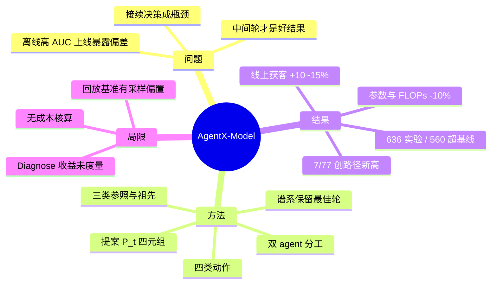
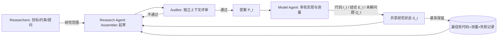

# AgentX-Model：面向工业推荐的长时程自主模型研究（arXiv:2609.30001）

> **英文标题**：Advancing Model Research in AgentX: Long-Horizon Autonomy for Industrial Recommender Systems
> **作者 / 机构**：Shuang Yang、Zijie Zhuang 等 24 人 / 快手（Kuaishou）
> **发表**：arXiv:2609.30001v1，2026-09-24；技术报告体例，正文 24 页 + 附录 4 节（不含参考文献约 30 页）
> **代码**：未开源
> **一句话**：把「模型研究」拆成 Research Agent 出提案、Model Agent 在沙箱里多轮实现与测量的双 agent 闭环，靠四类研究动作（Reproduce / Follow-up / Composition / Diagnose）让下一个实验建立在上一个的结果之上，约 25 天完成 636 个改模型实验、560 个 AUC 超业务基线。

## 思维导图

## 0. 三十秒速览

| 项 | 内容 |
|---|---|
| 解决什么问题 | agent 接管建模后，瓶颈从「写代码」变成「用上一个实验的结果决定下一个研究什么」——有用模型可能出自中间轮，组合模型暂时不如任一来源，离线更高的 AUC 上线后暴露校准偏差 |
| 核心手段 | 双 agent（Research 出经独立 Auditor 评审的提案、Model 多轮实现+测量）+ 共享研究状态 $S_t$ + 谱系化保留（每轮代码/测量/条件/失败都留）+ 四类动作 |
| 关键结果（离线） | 25 天 636 个改模型实验中 560 个 AUC 超业务基线：A 500/527（94.9%）、B 21/29（72.4%）、C 20/33（60.6%）、D 19/47（40.4%），A 场景 ΔAUC +0.023669（Table 4） |
| 关键结果（线上） | 最新 5 次 Launch Review 的 A/B：获客效率 +10~15%、目标人群广告花费 +15~20%、watch time +0.3~0.8%，watch-time 模型参数与 FLOPs 各少约 10%（Table 6） |
| 是否开源 / 是否上生产 | 未开源；已在快手多业务场景跑生产实验并上线 |
| 我最该记住的一点 | 「起始实现」与「判定参照」分离 + 保留最佳轮而非最后一轮：这两条决定了 agent 能不能真的接续研究，而不是每轮从头试 |

## 1. 摘要（忠实译述）

维持工业推荐研究的关键，是用一个实验的结果决定下一个该研究什么。我们提出 AgentX-Model，它是 AgentX 模型研究框架的下一代，把「提案生成」与「模型实验」连接在以业务输入和预测任务定义的沙箱之内。AgentX-Model 采用双 agent 架构：Research Agent 从论文与实验发现中发展出经独立评审的提案，Model Agent 执行多轮调查并交回代码、测量结果与未解问题。借助这些返回结果，Research Agent 选定起始实现并构造下一个研究问题，使后续实验能建立在更早的发现之上。我们把这种持续进行的研究组织成四类动作：Reproduce、Follow-up、Composition、Diagnose。前三类驱动常规研究，Diagnose 负责取得选择修复方案所需的证据——包括业务反馈与线上评估提出的问题，例如用 PCOC 度量的预测偏差。在生产评估中，636 个已完成的改模型实验里有 560 个录得高于其业务基线的 AUC。随着研究推进，部分实验录得的 AUC 高于其谱系中所有可比祖先。最近五次覆盖不同业务设置的线上 A/B 评估报告了获客效率 10–15%、目标人群广告花费 15–20%、watch time 0.3–0.8% 的提升；watch-time 模型使用的 FLOPs 与参数约少 10%。一个依赖感知的历史回放基准进一步用于评估研究资源分配，初步结果表明：当 agent 已经能分析并选择具体候选时，更复杂的调度并未带来一致的效率增益。

## 2. 核心贡献

1. **双 agent 研究框架（跨实验规划 + 实验内调查）**：Research Agent 出提案、Model Agent 做多轮调查，两者通过提案与返回值交接（§2.2）。为什么重要：单 agent 要么被训练日志淹没、要么只做一次性代码生成；把「视野」和「实现」分开，才能让一个实验的结论成为下一个实验的输入。
2. **四类研究动作**：Reproduce / Follow-up / Composition / Diagnose（§3.2.1）。前三类覆盖「引入方法、精修实现、组合来源」，第四类专门做**取证**——当多个解释都能拟合同一失败时，先设计定向观测/干预缩小不确定性，再决定修什么。为什么重要：这是把「调不动就换方向」这种人类直觉工程化，且 Diagnose 的产物不是更强模型而是**证据**。
3. **依赖感知的历史回放基准**：473 个实验节点、6 个环境，保留实验之间的继承/组合依赖（§4.5）。为什么重要：没有它就无法比较「下一个实验选哪个」的调度策略；有了它，作者能给出一个反直觉结论：固定任务类型轮转 + agent 选候选已经是强基线。

## 3. 问题与动机

工业推荐模型是「一串实验」推进出来的：工程师引入方法、看结果、决定精修还是换向（§1）。agent 接手实现之后，真正难的是接续决策，作者列了三种只有看结果才知道怎么办的情形：

1. 有用的模型可能来自**中间轮**而不是最终版；
2. 组合后的模型可能**暂时还不如**任一来源；
3. 离线 AUC 更高的模型，上线后可能暴露新问题（如校准偏差，§4.3.3）。

这三种情形共同指向一个工程约束：系统必须能在既定目标、约束与人工部署闸门内长时程自主运行，**不需要每个实验都重新向人提请求**（§1 对 autonomy 的定义）。作者也明确了本工作与母体 AgentX（2606.26859）的分工：AgentX 打通「想法→代码→上线」全链路，AgentX-Model 只专注模型研究这一段，且不碰上游特征采集、不重定义预测任务（§2.1）。

## 4. 方法

### 4.1 总体框架

沙箱由「业务输入 + 预测任务」定义：agent 可以改特征表示与交互、路由、骨架、连接、任务塔，可以增删替换合并调参，但上游采集与预测任务不动（§2.1）。每次实验都锚定到一个业务基线，起始实现可以是基线也可以是更早实验保留下来的模型；基线与起始实现的输入、标签、输出、结构以及代码引用都交给两个 agent。一次完整的接续研究写成：

### 4.2 提案与共享状态

提案 $P_t=(q_t,s_t,\delta_t,v_t)$：研究问题、起始实现、拟议改动或诊断干预、评测设计（含参照结果与成功判据）（Eq. 1）。返回值构成共享研究状态 $S_t=(I_t,E_t,Q_t)$：实现、附测量与比较条件的结论、未解问题（Eq. 2）。闭环为 $S_t\to P_t\to S_{t+1}$，上一轮的失败与回退也一并保留（§3.1）。

一个工程细节值得单独记：Research Agent 内部分成 Assembler 与 Auditor，**Auditor 在独立上下文中评审**，检查「改动 + 起始实现 + 评测」三者能否共同回答研究问题；通过后还有源码与版本检查绑定交付。附录 A.2 给了两个真实案例，初稿都通过了自动校验，是评审环节改掉了研究设计——这说明「独立评审」不是形式主义。

### 4.3 三类参照与最佳轮保留

接续研究先要选「拿谁当起点」。论文把三类参照分开（§3.2、Table 1）：**业务基线**衡量目标场景的收益；**直接父代**衡量相对所选来源实验的进展；**最强可比祖先**检验这条研究路径是否创了新高。对 AUC 比较，设 $V_i$ 为实验 $i$ 在同一评测条件下有效测量的轮次集合，最佳结果取 $\max_{r\in V_i}\mathrm{AUC}_r$。

配套的有两条纪律：轮次级代码连同测量、评测条件、诊断观察一起保留，**后续修订不覆盖已测最好的实现**；失败与回退同样保留，用来记录「自那次结果以来试过什么」（§3.2）。第三条最容易忽略：起始实现与判定参照可以分离——一个修复可以从诊断模型起步，但仍在追求更早实现的排序增益。

### 4.4 四类研究动作

1. **Reproduce**：把论文机制引入目标业务基线并做适配，改动要说明「新增什么、删掉哪条旧路径」，避免被当成加分支（§3.2.1）。
2. **Follow-up**：从有测量的实现出发追一个明确问题，且继承**最好的那一轮**而非最后一轮。
3. **Composition**：先对齐两个来源相对共同基线的完整有效改动，共享部分只保留一次、冲突处必须抉择；目标是超过任一来源路径的最佳可比结果，而不是堆模块。
4. **Diagnose**：取得选择修复方案所需的证据。例：当多个解释都能拟合同一失败时，调校准损失权重并跟踪学到的修正项与预测统计，把不确定性缩小再决定修什么；可接在任一类实验之后，也可作为后续实验的来源（§4.3.3）。

## 5. 实验与证据

### 5.1 设置

| 维度 | 内容 |
|---|---|
| 场景 | 快手 4 个业务评测设置（Scenario A–D），A 为运行最久的场景 |
| 基线 | 各场景当时的业务生产基线（基线会随模型迭代演进，每次结果记录基线版本） |
| 指标 | 离线 AUC（超基线阈值 $10^{-6}$）、线上 A/B 的业务指标（获客效率、目标人群广告花费、watch time、DAU 等） |
| 观测期 | 约 25 天生产期；线上为最新 5 次 Launch Review |
| 附加基准 | 依赖感知历史回放：473 个实验节点、6 个环境 |

### 5.2 主结果

离线（Table 4，Diagnose 实验不计入）：

| 场景 | 基线 AUC | 最佳 AUC | ΔAUC | 超基线/有效 |
|---|---|---|---|---|
| A | 0.773683 | 0.797352 | +0.023669 | 500/527（94.9%） |
| B | 0.815403 | 0.823145 | +0.007742 | 21/29（72.4%） |
| C | 0.816849 | 0.820246 | +0.003397 | 20/33（60.6%） |
| D | 0.809656 | 0.811432 | +0.001776 | 19/47（40.4%） |

线上（Table 6，5 次 Launch Review）：获客效率 **+10~15%**、目标人群广告花费 **+15~20%**、watch time **+0.3~0.8%**；watch-time 模型参数与 FLOPs 各少约 **10%**；其中一次 A/B 另报 DAU +0.5~1%、目标页关注 +3~4%。解读：A 场景绝对增益最大（+0.0237 AUC）且样本最多，D 场景只有四成实验能超基线，说明越靠后/越接近饱和的场景，agent 越难找到净增益。

按类别拆开（Table 5，Scenario A）：Composition 302/308（98.1%）、Follow-up 157/168（93.5%）、Reproduce 41/51（80.4%）。⚠️ 这不是成功率——Follow-up 与 Composition 大多继承已超基线的实现，正文明说了这一点（§4.3.1），因此「98.1% 超基线」不能读成「98.1% 的实验有效」。

### 5.3 消融与关键发现

- **接续的真实增量（Table 7）**：Scenario A 里，仅 7/77 个 Follow-up、5/120 个 Composition 的 AUC 超过其**全部**可比祖先；46/91 的 Follow-up 超过直接父代。也就是说大部分「超基线」是继承来的，真正创路径新高的比例很低——这条比主结果更能说明 agent 研究的边际收益。
- **必须保留最佳轮**：189 个多轮实验中，91 个（48.1%）的最终轮低于此前最佳轮。若按「取最后一次提交」的常规做法，近一半实验会被白白浪费。
- **研究饱和**：Scenario A 固定基线下的 453 个提案显示，最佳 AUC 记录随研究问题切换而**趋于平台**（§4.3.2）。
- **调度策略对比（§4.5）**：在 replay 基准上，bandit / joint 等更复杂调度**没有**一致优于「固定任务类型轮转 + agent 选候选」；Scenario C 上 joint 平均 10.67 次才选到共同终点，fixed 为 14.67 次。
- **提案生产效率（Table 3）**：886 次尝试 → 262 份交付；200 份子集中 198 份有输出、177 份有可验证测量；中位 33.6 分钟、P90 49.9 分钟。

### 5.4 证据边界

- **有支撑**：在 4 个真实业务场景、约 25 天生产期内，agent 产出的模型改动确实能超过业务基线并有 5 次线上 A/B 佐证；最佳轮保留、谱系参照这两条工程纪律有明确数据支持。
- **弱支撑**：跨场景知识迁移（Table 9）与指令修订评估都是无匹配预算的小样本比较；Diagnose 因「信息价值 ≠ 即时 AUC」被排除在调度对比之外，其收益**没有被度量**（§4.5 自述）。
- **无支撑**：论文没有给出「agent 研究 vs 人类研究团队」的对照，也没有给出单位增益的算力/成本账；「560/636 超基线」不能当作成功率或效率证据。

## 6. 深度分析

### 6.1 为什么可能有效（机制层）

三个机制与结果模式是对得上的：其一，**中间轮保留**把「搜索过程」而非「搜索终点」变成资产，直接解释了为什么 48.1% 的实验终轮反而更差却仍能持续产出；其二，**三类参照分离**让 agent 能区分「相对父代的局部恢复」和「相对祖先的路径新高」，后者才对应真正的创新，这也解释了为什么表 5 的 98.1% 与表 7 的 6% 级形成巨大反差；其三，**Diagnose 作为取证动作**把「校准偏差」这类只能在线上暴露的问题，转成线下可观测的干预实验（Table 8 的 before/after 对比），从而让研究不被卡在「AUC 涨了但业务指标不动」。

### 6.2 可疑之处

1. **口径含糊的「超基线」**：94.9% / 98.1% 这类比例极易被误读为成功率，论文虽在 §4.3.1 声明不是，但摘要只写「560 of 636」不加限定，传播中几乎必然被当成成功率。
2. **场景差异被平均掉**：A 场景 ΔAUC +0.0237、D 场景 +0.0018，相差一个数量级；线上 5 次 A/B 又只给**区间**不给置信区间与样本量，无法判断 +0.3~0.8% 的 watch time 是否在噪声内。
3. **replay 基准的选择偏置**：基准建立在历史已执行路径上，候选集受历史采样限制；论文自述 Scenario A 有 83 个 Composition 在 15 次运行中**始终未解锁**（§4.5），这会系统性低估「探索型」策略。
4. **Diagnose 的价值被排除在度量之外**：承认它不属于即时 AUC 收益，但也就意味着整套系统的收益账只算了「能涨 AUC 的那部分」，校准修复这类真实业务收益没有进入对比。
5. **人力/成本账缺失**：只有提案中位 33.6 分钟，没有 GPU-小时、token 成本、人工评审工时；没有这些，无法判断相对人类工程师是否真的更便宜。

## 7. 与同族工作对比

| 工作 | 核心差异 | 相对优势 | 相对短板 |
|---|---|---|---|
| 本文 2609.30001 | 双 agent（规划/调查分离）+ 四类动作 + 谱系化接续 | 接续研究做得最细：三类参照、最佳轮保留、Diagnose 取证 | 只覆盖模型研究一段，不含上线链路；无成本账 |
| AgentX 2606.26859（快手） | 四阶段生产闭环，打通想法→代码→上线 | 端到端、覆盖部署闸门 | 实验内部的「接续」粒度粗，无谱系/祖先参照 |
| Auto-RecSys 2609.10922（Meta+UIUC） | 异步并行实验 + 跨服务器共享记忆 + 双反馈环 | 吞吐与多机协同强 | 更偏系统编排，单实验内的诊断深度弱 |
| RecHarness 2607.29241（GT+快手） | 用 bandit 在修改方向上做路由 | 方向选择有显式探索-利用权衡 | 本文 §4.5 的结果显示：agent 已能选候选时，复杂调度未必更好 |

> 上表只比较机制定位；除本文外三篇的具体数字本笔记未逐一复核原文。

## 8. 可迁移 / 复现要点

1. **先搭「证据三件套」再谈自动化**：每轮实验强制保留 代码 + 测量（含评测条件）+ 失败原因，并在提案里显式写「起始实现」与「判定参照」两个字段。复现成功判据：任意一次 Follow-up 都能追溯到父代与祖先的 AUC 记录。
2. **把「最后一轮」改成「最好的一轮」**：实现层面就是给每个实验维护 `best_round` 指针，禁止覆盖写。这一条改动成本最低、收益最直接（对应 48.1% 的反例）。
3. **给 agent 加一个「取证动作」**：当两次修复都失败时，强制先做一次定向观测（改一个可疑因素、记录中间统计），把结论写成证据条目再继续，而不是继续盲试。
4. **用「超祖先比例」而非「超基线比例」评估系统**：前者才是研究增量，后者会被继承实现污染。可以直接沿用本文的父代/祖先/基线三重参照定义。

## 9. 局限与未解决问题

- **作者自述**：replay 基准受历史采样限制、部分组合路径始终未解锁；Diagnose 收益未纳入对比；知识迁移与指令修订是小样本探索（§4.5、§4.4）。
- **我读出的**：缺少与人类工程师的对照与成本核算；线上指标只给区间；A/D 场景差异巨大但未讨论原因（是场景饱和、还是 agent 对某类结构更擅长？）。
- **值得做的后续**：① 用同一 replay 基准补一个「不使用谱系/祖先信息」的消融，量化接续机制本身的贡献；② 把 Diagnose 的收益定义成「缩短修复所需实验数」，这类可测指标；③ 在 A 场景上做「饱和后继续投入 vs 换新研究问题」的策略研究，本文只观察到平台期，没有给出何时该停。

## 10. 术语表

| 术语 | 含义 |
|---|---|
| Proposal $P_t$ | 一次实验的研究设计：问题、起始实现、改动、评测设计与成功判据 |
| Research state $S_t$ | 实现 + 附条件的结论 + 未解问题，跨提案共享 |
| Follow-up / Composition | 在已有实现上继续追问题 / 组合两个来源的有效改动 |
| Diagnose | 以取得证据为目的的诊断实验，不直接追求指标提升 |
| 可比祖先 | 同一谱系中与当前实验可比的最强历史结果，用于判断是否创路径新高 |
| Launch Review (LR) | 上线评审，本文线上结果来自最近 5 次 LR |
| PCOC | 业务侧度量预测偏差的指标，用于触发校准类 Diagnose |
| replay benchmark | 保留实验依赖关系的历史回放基准，用于比较「下一个实验选什么」的调度策略 |

## 11. 原文定位

| 内容 | 位置 |
|---|---|
| 双 agent 分工 | §2.2 |
| 提案方程 Eq. (1)、状态 Eq. (2) | §2.2 |
| 研究闭环 $S_t\to P_t\to S_{t+1}$ | §3.1 |
| 三类参照与最佳轮保留 | §3.2、Table 1 |
| 四类研究动作 | §3.2.1 |
| 离线主结果 | Table 4（§4.3.1） |
| 分类别结果 | Table 5 |
| 线上 A/B | Table 6 |
| 接续/祖先参照结果 | Table 7（§4.3.2） |
| 校准修复案例 | Table 8（§4.3.3） |
| 跨场景知识迁移 | Table 9（§4.4） |
| 调度策略对比 | §4.5 |
| 经验教训 | §6 |
